# Nipuna CRM — API

The Flask backend: architecture, conventions, build order, every endpoint, and function-level execution flows.

| Part | Covers |
|---|---|
| [Part A — Build plan and endpoints](#part-a--build-plan-and-endpoints) | Architecture, conventions, build order and every endpoint with "As built" notes |
| [Part B — Execution flows](#part-b--execution-flows) | Function-by-function flowcharts of the request pipeline and the health, auth, users, roles, branches and staff endpoints |

---

## Part A — Build plan and endpoints

Flask backend over the `nipunacrm` PostgreSQL database (schema in `db/`, see [DATABASE.md](DATABASE.md)).
This plan covers the code structure, the conventions every endpoint follows, and the order in which to build the APIs: auth first, then master data, then the 15 sidebar sections in dependency order.

---

### 1. Architecture

#### Layers

A request flows top to bottom. Each layer only talks to the one directly below it.

| Layer | Folder | Responsibility | Must not |
|---|---|---|---|
| Routes | `backend/routes/` | Blueprints: URL + HTTP method, auth / role decorators (`routes/decorators.py`), call the controller | Contain logic or queries |
| Controllers | `backend/controllers/` | Read and validate the request (`Validator` in `controllers/common.py`), call the service, return JSON via `model.to_dict()` | Touch the database |
| Services | `backend/services/` | Business rules, permission and branch-scope checks, audit log, creating tasks / notifications. Also shared: `errors.py`, `security.py` (passwords / tokens), `context.py` (current user) | Build HTTP responses |
| Repositories | `backend/repositories/` | Database queries: filters, joins, pagination, reading views. Shared: `common.py` (`paginate`, `set_db_user`) | Contain business rules |
| Models | `backend/models/` | SQLAlchemy classes mapped to the existing tables and views, each with `to_dict()` for responses | Create or alter tables |
| Config | `backend/config/` | Settings per environment, the shared `db` object, logging, JSON encoding | Import from any other layer |

No separate `core/` or `schemas/` folders: shared helpers live in the layer that uses them.

**When to use a repository:** every module that lists, filters or aggregates data gets one (leads, pipeline, payments, collections, students, tasks, reports, dashboard). Simple lookups and single-row reads can use the model directly from the service. If a service method grows a query longer than a few lines, move it to a repository.

#### Folder structure

```
nipuna-crm/
├── backend/
│   ├── app.py                 # Entry point: create_app() + `python app.py` / `flask --app app run`
│   ├── config/
│   │   ├── __init__.py        # get_config(env) → Dev / Test / Prod
│   │   ├── settings.py        # Config classes read from .env (DATABASE_URL, SECRET_KEY, ...)
│   │   ├── database.py        # db = SQLAlchemy()  ← models and repositories import db from here
│   │   ├── json_provider.py   # ISO dates, money as strings
│   │   └── logging.py
│   ├── models/                # one file per domain (access.py, masters.py, system.py, leads.py, ...), with to_dict()
│   ├── repositories/
│   │   └── common.py          # paginate(), set_db_user()
│   ├── services/
│   │   ├── errors.py          # AppError, ValidationError, NotFound, BusinessRule, ...
│   │   ├── security.py        # password hashing, session tokens
│   │   └── context.py         # CurrentUser for the request (roles, branches, fresh auth)
│   ├── controllers/
│   │   └── common.py          # ok() / created() / paginated(), Validator, get_page_params(), exception → error response
│   ├── routes/
│   │   ├── __init__.py        # register_blueprints(app) — the only list of blueprints
│   │   └── decorators.py      # @login_required, @require_roles, @fresh_auth
│   ├── cli/                   # flask create-admin, flask jobs run
│   ├── tests/
│   ├── .env / .env.example
│   └── requirements.txt
├── db/                        # SQL migrations (source of truth for the schema)
├── frontend/                  # React SPA connected to this API (see docs/DEVELOPMENT.md, Part B)
├── prototype/                 # Lovable frontend prototype v1.1 (reference; `npm install && npx vite dev`)
├── venv/
└── docs/                      # PRODUCT_GUIDE.md, DATABASE.md, API.md, DEVELOPMENT.md
```

**`app.py` is independent:** it is the only place that builds the application — it loads config, initialises `db`, registers error handlers, blueprints (via `routes.register_blueprints`) and CLI commands. **No other module imports from `app.py`**: models and repositories get `db` from `config.database`, and routes are plain blueprints. This avoids circular imports and lets tests call `create_app("test")` directly.

`app.py` also holds the per-request transaction hook (commit on success, roll back on error) and the error handler that turns every exception into the standard error response.

Commands are run from `backend/`: `flask --app app run`, `flask --app app create-admin`, `pytest`.

Every module uses the same file names across layers, e.g. `routes/leads.py → controllers/leads.py → services/leads.py → repositories/leads.py → models/leads.py`.

#### Key decisions

| Decision | Choice | Why |
|---|---|---|
| Schema ownership | SQL files in `db/` stay the source of truth. Models map to existing tables; never run `db.create_all()` or Alembic autogenerate | The schema relies on triggers, views, enums and constraints that autogenerate can't express |
| Auth tokens | Opaque session token (random 256-bit), sent as `Authorization: Bearer <token>`; only its SHA-256 hash is stored in `user_sessions` | The prototype requires a 30-min idle timeout, a 12-hour max session, revocation and fresh auth for sensitive actions — all need server-side sessions, which JWTs don't give |
| Password hashing | `werkzeug.security` (`generate_password_hash` / `check_password_hash`, scrypt) | Already installed with Flask |
| Validation | Small `Validator` in `controllers/common.py` (string, email, integer, boolean, datetime, list); responses via `model.to_dict()` | No extra library or schema layer; keeps each endpoint's rules visible in its controller |
| Tests | pytest against a `nipunacrm_test` database built from `db/*.sql`, each test in a rolled-back transaction | Exercises the real triggers |

---

### 2. Conventions (all endpoints)

**URLs:** prefix `/api/v1`, plural nouns (`/leads`, `/leads/{id}/activities`). Actions that aren't plain updates are sub-resources: `POST /payments/{id}/verify`, `POST /special-closing-requests/{id}/approve`.

**Success response**
```json
{ "data": { ... } }
{ "data": [ ... ], "meta": { "page": 1, "per_page": 25, "total": 132 } }
```

**Error response**
```json
{ "error": { "code": "VALIDATION_ERROR", "message": "Phone is required", "details": { "phone": ["Required"] } } }
```

| Situation | Status | `code` |
|---|---|---|
| Invalid input | 400 | `VALIDATION_ERROR` |
| No / expired / idle session | 401 | `UNAUTHENTICATED` |
| Sensitive action without recent login | 401 | `FRESH_AUTH_REQUIRED` |
| Role or branch not allowed | 403 | `FORBIDDEN` |
| Not found or outside the user's branches | 404 | `NOT_FOUND` |
| Unique violation (Postgres 23505) | 409 | `CONFLICT` |
| Academic write while the LMS owns academics (step 23) | 409 | `MANAGED_IN_LMS` |
| Business rule from a trigger (`RAISE EXCEPTION`, P0001) or check constraint (23514) | 422 | `BUSINESS_RULE` — message passed through from the database |
| Foreign key violation (23503) | 422 | `INVALID_REFERENCE` |
| Exclusion (23P01) or not-null (23502) violation | 422 | `BUSINESS_RULE` |
| Invalid text representation (22P02) | 400 | `VALIDATION_ERROR` |
| Temporary password not yet changed | 403 | `PASSWORD_CHANGE_REQUIRED` |
| Too many failed logins (account locked) | 429 | `TOO_MANY_ATTEMPTS` |

The database triggers already return readable messages ("Prerequisite missing: first qualifying allocated payment must be Verified by Accounts"). `controllers/common.py` (`error_response_for`) maps them to the table above, so services don't duplicate every rule — they only pre-check where a friendlier message or an early exit helps.

**Lists:** `?page=1&per_page=25` (max 100), `?sort=-created_at`, filters as query params (`?branch_id=1&stage=Counselling&q=ananya`).

**Data formats:**
- Money as strings with 2 decimals (`"27000.00"`), `Decimal` in Python — never floats.
- Timestamps in ISO 8601 with offset; business dates in IST (`business_tz()`).
- Enum values exactly as stored (`"Payment Pending Verification"`).
- IDs: numeric `*_id` for references, plus the human code (`lead_code`, `admission_code`, `receipt_number`) in every response.

**Every request (handled once, in `routes/decorators.py`, `services/auth.py` and `app.py`):**
1. Resolve the bearer token → `active_sessions` row → user and active role scopes (unrevoked, unexpired `user_role_scopes`; `repositories/users.py`). Throttle `last_seen_at` updates to once a minute.
2. Open one transaction per request and run `SET LOCAL app.current_user_id = '<id>'`, so triggers credit stage changes, task completions and so on to the user.
3. Branch scoping: list endpoints filter to the user's branches unless they hold a company-wide role; single-record reads return 404 outside scope.
4. Commit on success, roll back on any error.

**Audit:** services write `audit_log` for creates / updates of sensitive records (approvals, payments, fee changes, refunds, role scopes, settings) with old and new values.

---

### 3. Build order

#### Overview

| Step | Module | Sidebar section | Why this position |
|---|---|---|---|
| 0 | Foundation | — | App skeleton, DB, errors, responses, tests |
| 1 | **Auth & access** | — (login screen, Admin → Users & Access) | Every other endpoint needs the current user and role scopes |
| 2 | Master data | #15 Course Master, More → Offer Master | Leads need courses, lookups and branches; fees need offers and plans |
| 3 | Internal core services | — | Audit, task and notification creation, used by later modules |
| 4 | Leads | #2 Leads (+ Counsellor workspace) | Start of the sales flow |
| 5 | Pipeline | #3 Pipeline | A view over leads |
| 6 | Demos | #4 Demos | Needs leads |
| 7 | Fee discussions & special closing | inside lead detail ("Fees / Offers") | Needs leads, offers, plans; needed before payments |
| 7b | Invoices | Invoice Register (from Payments / Fee Discussion) | Issued from an approved fee version; payments and dues hang off invoices |
| 8 | Payments | #7 Payments | Admission requires a verified payment |
| 9 | Admissions & academics | #5 Admissions | Needs accepted fee plan + verified payment |
| 10 | Students | #6 Students | Aggregates admissions, payments, documents |
| 11 | Collections | #8 Collections | Needs admissions + installments |
| 12 | Refunds & support cases | #9 Refunds | Needs admissions + payments |
| 13 | Tasks | #10 Tasks | Links to all earlier records |
| 14 | Communications & notifications | #11 Communications, More → Notifications | Links to persons / leads; notification UI |
| 15 | Placement & Alumni | #13 Placement & Alumni | Needs students + completed admissions |
| 16 | Reports & targets | #12 Reports, More → Target Master | Reads everything |
| 17 | Dashboard | #1 Dashboard (+ Branch Manager / Founder views) | Aggregates everything, so built last among the core |
| 18 | Admin / Settings | More → Admin / Settings | Integration status, incidents, sessions, deletion approvals |
| 19 | AI Copilot | #14 AI Copilot, More → Ask Nipuna | Needs real data and an external LLM |
| 20 | Background jobs | — | Escalations, reminders, scheduled reports |
| 21 | **V4 — deals, multi-course invoices, receipts** | Leads, Deal pipeline, Invoices, Payments & receipts, Admissions | UI V4 handoff (see [DEVELOPMENT.md · Part D (V4 plan)](DEVELOPMENT.md#part-d--v4-handoff-plan-and-review)); db 019–022 |
| 22 | LMS sync (outbox) | — | Sends admissions, courses and finance to the Nipuna LMS; db 026 |
| 23 | LMS status pull | Batches, Admissions, Student 360, LMS access | Mirrors what the LMS owns (login, LMS status, academics, batches, certificates); academic screens read-only; pause / resume; db 027–028; batch offerability (db 032). Curriculum mapping (db 030, round 3) was removed by db 043 |
| 24 | CRM AI sales playbook | My work, Lead 360 workbench, Person 360, More → Sales playbook | Front Office queue, outcomes, objections, contact rules, approved knowledge, course suggestions, recovery lists, measures; db 031 |
| 27 | Curriculum removal | Admissions, Batches, Lead 360, Waiting for batch | No curriculum versions or mapping; Academic Coordinator merged into Branch Manager; db 043 |

Dashboard is sidebar item #1 but is built late: it only displays numbers produced by the other modules.

#### Milestones

| Milestone | Steps | Outcome |
|---|---|---|
| M1 — Platform | 0, 1, 2, 3 | Staff can log in; masters are manageable |
| M2 — Sales | 4, 4b, 5, 6, 7 | Enquiry → lead → demo → approved fee |
| M3 — Sales-to-cash | 7b, 8, 9, 11, 12 | Invoice → payment → admission → collections → refunds |
| M4 — Student & operations | 10, 13, 14 | Student 360, tasks, inbox, notifications |
| M5 — Management | 15, 16, 17, 18 | Placement, reports, targets, dashboards, admin |
| M6 — Intelligence & automation | 19, 20 | AI features, scheduled jobs |
| M7 — UI V4 | 21 | Qualify → convert → delivery plan → multi-course invoice → claim → verified receipt → admission per course |
| M8 — LMS | 22, 23 | Every admission, course and balance reaches the LMS as it changes; the LMS's academic state comes back |
| M9 — Front Office playbook | 24 | One ordered daily queue, a 10-minute first response, honest outcomes and contact rules, assisted (never automatic) messaging |

---

### 4. Module details

Roles below use the codes in `roles`: `FOUNDER_CEO`, `SUPER_ADMIN`, `BRANCH_MANAGER`, `SALES`, `FRONT_OFFICE`, `ACCOUNTS`, `TRAINER`, `PLACEMENT`, `HR`, `STUDENT`. "Admins" means Founder / CEO or Super Admin. "Counsellors" means Sales or Front Office.

#### Step 0 — Foundation ✅

- Create `backend/` with the folder structure above; move `requirements.txt` and `.env.example` into it.
- `backend/app.py` (`create_app()`), `config/` (settings per environment, `database.py`, logging), `.env` loading.
- `controllers/common.py` (responses, validation, page params, error mapping), `services/errors.py`, `repositories/common.py`, `routes/__init__.py`.
- `GET /api/v1/health` → app + database status.
- pytest setup: build `nipunacrm_test` from `db/*.sql`, per-test rollback fixture, test client.
- Add to requirements: `pytest` (done). No `flask-cors`: the frontend is a separate SPA (`frontend/`) served on the same origin — the Vite dev server proxies `/api` in development and a reverse proxy does the same in production (see [DEVELOPMENT.md · Part B (frontend)](DEVELOPMENT.md#part-b--frontend)).
- Run tests from `backend/`: `pytest` (rebuilds `nipunacrm_test` from `db/*.sql` each run). `flask --app app create-test-db` rebuilds it manually.

#### Step 1 — Auth & access ✅

Tables: `users`, `user_role_scopes`, `roles`, `branches`, `user_sessions`, `audit_log`.

| Method | Path | Who | Notes |
|---|---|---|---|
| POST | `/auth/login` | Public | Email + password → token, user, scopes, allowed branches. Creates a `user_sessions` row. Generic error message; log failures |
| POST | `/auth/logout` | Logged in | Revokes the current session |
| GET | `/auth/me` | Logged in | User, active scopes, allowed branches, home route (Counsellor workspace / Branch Manager dashboard / Dashboard, as in the prototype) |
| POST | `/auth/reauthenticate` | Logged in | Password → sets `reauthenticated_at` (fresh auth, 15 min) |
| POST | `/auth/change-password` | Logged in | Needs current password; revokes the user's other sessions |
| GET | `/auth/sessions` | Logged in | Own active sessions |
| DELETE | `/auth/sessions/{session_id}` | Logged in | Sign out another device |
| GET | `/users` | Admins | Filter by role, branch, active |
| POST | `/users` | Admins, fresh auth | Create user + initial scopes; returns a one-time temporary password |
| GET / PATCH | `/users/{id}` | Admins | Profile fields, `is_active` |
| POST | `/users/{id}/reset-password` | Admins, fresh auth | New temporary password; revokes the user's sessions |
| GET | `/users/{id}/scopes` | Admins | Including expired / revoked |
| POST | `/users/{id}/scopes` | Admins, fresh auth | Role + branch (+ `expires_at` for temporary access) |
| DELETE | `/users/{id}/scopes/{scope_id}` | Admins, fresh auth | Revoke (sets `revoked_at`; never deletes) |
| GET | `/roles`, `/branches` | Logged in | For dropdowns |
| GET | `/staff?branch_id=&role=SALES,FRONT_OFFICE` | Logged in | Staff directory for owner / trainer / task-owner pickers: active users with active scopes at the caller's branches (plus company-wide scopes), one entry per user with their matching roles. Other branch → 404. Added with the frontend |

Also:
- `flask create-admin` CLI command to create the first Founder / Super Admin (there are no users yet).
- Decorators: `@login_required`, `@require_roles("SUPER_ADMIN", "FOUNDER_CEO")`, `@fresh_auth`, and branch checks via `CurrentUser.has_role(*roles, branch_id=)` / `can_access_branch()` (`services/context.py`).
- Recovery account (`is_recovery_account`): allowed to log in, every action audited.

**Done when:** login, logout, me, idle timeout (31 min → 401), max session (12 h), revoked scope loses access immediately, fresh-auth enforcement — all covered by tests.

**As built** (migration `db/011_auth.sql` added `must_change_password`, `password_changed_at`, `failed_login_attempts`, `locked_until` and three settings):
- Admin-created users and password resets get a one-time temporary password; until it's changed, only `/auth/me`, `/auth/logout` and `/auth/change-password` work (403 `PASSWORD_CHANGE_REQUIRED`).
- 5 failed logins lock the account for 15 minutes (429 `TOO_MANY_ATTEMPTS`); both values and the 10-character minimum password length are in `app_settings`.
- Login counts as fresh auth for 15 minutes.
- Only a Founder / CEO can grant Founder / CEO access or create a recovery account; admins can't change their own access, deactivate or reset themselves.
- Granting a role whose previous grant expired closes the expired one automatically.
- `services/audit.py` (planned for step 3) was built here because auth needs it.

#### Step 2 — Master data ✅

Tables: lookup tables, `branches`, `branch_shifts`, `holidays`, `courses`, `course_branches`, `combo_courses`, `payment_plans`, `payment_plan_installments`, `offers` (+ scope / complimentary tables), `concession_limits`, `app_settings`, `document_types`, `task_types`, `support_case_types`.

| Method | Path | Who | Notes |
|---|---|---|---|
| GET | `/lookups` | Logged in | All dropdown lists in one call (sources, channels, entry methods, payment modes, lost reasons, task / document / support case types, enums) |
| POST / PATCH | `/lookups/{type}` , `/lookups/{type}/{id}` | Admins | Add / rename / deactivate (never delete) |
| GET / PATCH | `/branches/{id}` | GET: logged in (no branch-scope check — see DEVELOPMENT.md, Part E backlog); PATCH: admins | Contact details |
| GET / PUT | `/branches/{id}/shifts` | GET: logged in; PUT: admins | Staffed hours (drive all SLA deadlines) |
| GET / POST / DELETE | `/holidays` | Admins | |
| GET | `/courses` | Logged in | Filters: standalone / combo, category, status, branch |
| POST / PATCH | `/courses`, `/courses/{id}` | Admins | Code, title, category, standard fee, status |
| PUT | `/courses/{id}/branches` | Admins | Branches offering the course |
| PUT | `/courses/{id}/components` | Admins | Combo components (incl. the "+1" bonus course) |
| GET / POST / PATCH | `/payment-plans` | Admins | Installments with due-day windows |
| GET | `/offers` | Admins, Branch Manager | Versions with status |
| POST | `/offers` | Admins | New draft (or new version of an existing code) |
| PATCH | `/offers/{id}` | Admins | Draft only |
| POST | `/offers/{id}/activate`, `/offers/{id}/deactivate` | Admins, fresh auth | Activation needs approver + dates |
| PUT | `/offers/{id}/scope`, `/offers/{id}/complimentary-courses` | Admins | Branches, courses, complimentary thresholds + access period |
| GET / PUT | `/concession-limits` | Admins, fresh auth | Per role |
| GET / PATCH | `/settings` | Admins, fresh auth | `app_settings` |

**As built (step 2):**
- Also `GET /lookups/{type}` (admins, includes inactive values). Lookup codes are fixed once created; values are deactivated, never deleted.
- Offers: `POST /offers` rejects an existing code — use `POST /offers/{id}/new-version` (copies the version into the next Draft). `PATCH` can move Draft ↔ Configured; activating a version deactivates the other active version of the same code.
- Payment plan installments can't be changed once a fee discussion or admission uses the plan (create a new plan).
- Settings keep their type (a number stays a number); only existing keys can be changed.
- Past holidays can't be deleted (they explain past deadlines).

#### Step 3 — Internal core services (no public API yet) ✅

Built now so later modules can call them; their screens come in steps 13–14.
- `audit_service.record(action, entity, old, new, reason)`.
- `task_service.create_system_task(type, title, branch, due, linked_record, dedupe_key)` — idempotent via `dedupe_key`.
- `notification_service.notify(rule_code, event_key, entity, recipients)` — resolves recipients from the rule's role + branch, deduplicated.
- `sla_service.staffed_deadline(branch, start, minutes)` → wraps `add_staffed_minutes()`.

**As built (step 3):** `services/tasks.py` (`create_system_task`, `complete_system_task`), `services/notifications.py` (`notify`), `services/sla.py` (`staffed_deadline`, `add_working_days`, `working_day_end`); `services/audit.py` came with step 1.

#### Step 4 — Leads (sidebar #2) ✅

Tables: `persons`, `enquiries`, `leads`, `lead_activities`.

| Method | Path | Who | Notes |
|---|---|---|---|
| GET | `/persons/search?phone=&email=&name=` | Counsellors, BM | Duplicate check before creating (never auto-merge) |
| POST / GET / PATCH | `/persons`, `/persons/{id}` | Counsellors, BM | |
| GET | `/persons?q=&branch_id=&page=` | Lead roles, branch-scoped | Persons section: registered at, or with a lead at, the user's branches (403 for another branch), newest first. `q` matches the name, email or person code, or (4+ digits) the mobile / alternate number. Rows add `leads_count`, `active_leads` and `open_cards` (added with DB 017) |
| GET | `/persons/{id}/overview` | Lead roles, branch-scoped | Person 360: `person`, `pipeline_cards` (open first), `leads` (all, newest first), `admissions` (original or service branch in scope) |
| POST | `/enquiries` | Counsellors, BM | Records the enquiry; returns possible person / lead matches. Matches go to `Duplicate Review` |
| GET | `/enquiries?intake_status=Duplicate Review` | BM, Counsellors | Duplicate review queue |
| POST | `/enquiries/{id}/link` | BM, Counsellors | Link to an existing person / lead (manual decision) |
| POST | `/leads` | Counsellors, BM | Person + enquiry + lead in one transaction |
| GET | `/leads` | Counsellors (own + branch), BM, Admins | Filters: branch, stage, owner, source, intake, priority, course, search; queue tabs: New, Untouched, Due Today, Overdue, Hot, Demos, Fee Discussion, Payment Pending Verification, Collections, Cold / Reactivation, Future Joining |
| GET | `/leads/workspace` | Counsellors | Today's prioritised queue for the logged-in counsellor |
| GET / PATCH | `/leads/{id}` | Scoped | Detail header (person, stage, priority + score, owner, sales summary) |
| POST | `/leads/{id}/assign` | BM | Reassign owner |
| POST | `/leads/bulk-assign` | BM | Many leads → one owner |
| POST | `/leads/{id}/stage` | Owner, BM | Stage change; DB blocks backward moves after Payment Pending Verification |
| POST | `/leads/{id}/follow-up` | Owner, BM | Set next follow-up |
| POST | `/leads/{id}/lost` | Owner, BM | Reason, optional competitor, notes, reactivation date |
| POST | `/leads/{id}/reactivate` | BM | |
| GET / POST | `/leads/{id}/activities` | Scoped | Timeline; log call / WhatsApp / note |
| GET | `/leads/{id}/enquiries` | Scoped | "Enquiry" tab |

**As built (step 4):**
- Also `POST /enquiries/{id}/convert` (enquiry → new lead for an existing or new person) and `GET /enquiries/{id}`.
- Phone numbers are normalised to `+91XXXXXXXXXX`. Person search works across all branches (so a second-branch enquiry is found); person records are otherwise visible only where the person is registered or has a lead.
- Who can do what: counsellors see all leads at their branches; stage / follow-up / lost / edit need the owner, a branch manager or an admin (any branch counsellor while unassigned); assign, bulk assign and reactivate need a branch manager or admin; any lead role at the branch can log activities.
- A counsellor who creates a lead owns it. An unassigned lead creates a system task for the branch manager (due in 60 staffed minutes — an assumption, not from the prototype), completed automatically on assignment.
- Stage `Admitted` can't be set by hand (the admission sets it) and `Lost - closed` goes through `/lost`. Moving to Payment Pending Verification needs a course.
- Queue tabs (`?queue=`): new, untouched, due_today, overdue, hot, demos, fee_discussion, payment_pending, cold, future_joining. "Collections" arrives with step 11.

#### Step 4b — Leads: prototype v1.1 additions ✅

Schema is ready (`db/012_prototype_v1_1.sql`); these extend the step 4 endpoints.

| Method | Path | Who | Notes |
|---|---|---|---|
| POST / PATCH | `/leads`, `/leads/{id}` | as step 4 | Accept `campaign` (campaign / referral) and `remarks`; person accepts `whatsapp_number` (empty = same as mobile) |
| POST | `/leads` with `person_id` | Counsellors, BM | "Add Another Course": new opportunity for the same person; branch must be in the caller's scope, owner valid for that branch |
| POST | `/leads/{id}/follow-up-log` | Owner, BM, Front Office | Purpose (Counselling call / Demo confirmation / Post-demo / Fee / Collection / Document follow-up) + response (Interested / Call back later / Not reachable / Needs time / Not interested) + notes + next follow-up (required). Writes a `Call` activity (`purpose`, `outcome` = response), moves the next follow-up, creates a Call task; the original deadline is kept |
| GET / POST / DELETE | `/saved-views?module=leads`, `/saved-views/{id}` | Lead roles | Shared views (seeded) + the user's own; `filters` use the `GET /leads` query params |
| POST | `/lead-imports` | Counsellors, BM | Upload CSV (full_name, mobile, email, course, branch, source). Each row validated: phone format, email, course in Course Master, branch exists **and is in the caller's scope**; matches → `Duplicate Review` (never merged); invalid rows get `issues` |
| GET | `/lead-imports/{id}` | Uploader, BM | Field mapping + rows with validation result |
| POST | `/lead-imports/{id}/import` | Uploader, BM | Creates enquiries + leads for Ready and Duplicate Review rows (entry method `CSV import`); skips Invalid; import alone doesn't satisfy the lead SLA |

Intake statuses now also include `Invalid-Spam` and `Test` (staff-settable).

**As built (step 4b):**
- WhatsApp number: empty string or null = same as mobile; responses show the effective number.
- Follow-up log writes a `Call` activity (direction Outbound) and a Call task whose *original* deadline is the lead's previous follow-up (or now) and whose *revised* deadline is the new one — the prototype's "original deadline kept".
- Saved views: anyone with a lead role keeps private views; shared views are created by admins / branch managers and deleted by admins only.
- CSV import accepts multipart `file` or JSON `{file_name, content}`; max 1,000 rows; course matched by code or title, branch by code / name / city / prefix, source by code or label (case-insensitive); also flags "Course not offered at branch" and a phone repeated inside the file (→ Duplicate Review). Channel for imported enquiries = Web form (as the prototype). Duplicate Review rows become new people whose lead stays in Duplicate Review (never merged); access = uploader, admins, or a BM of a row's branch.
- `normalise_phone` moved to `services/persons.py` (services no longer import controllers).

#### Step 5 — Pipeline (sidebar #3) ✅ — V4 chips, columns, values and next actions in step 21

| Method | Path | Notes |
|---|---|---|
| GET | `/pipeline?branch_id=&owner_id=` | Stages in order with counts and lead cards (Kanban) or rows (Table) |
| POST | `/leads/{id}/stage` | Reused from Leads; returns missing required fields when moving to Payment Pending Verification / Admitted. Since 017 it moves the person's card |

**As built (step 5):** `GET /pipeline?view=kanban|table&branch_id=&owner_id=me|unassigned|{id}&course_id=&source_id=&priority=&q=&per_stage=` (lead roles). Kanban returns all 8 stages with counts and up to `per_stage` cards (default 20, max 100) ordered by next follow-up; Table is paginated in stage order. Moving to Admitted by hand returns 422 with `missing_fields: ["admission"]`.

**As built (person pipeline, DB 017):** the pipeline lists **persons**, not leads. Each card is one `pipeline_entries` row per person per branch, and all of the person's open courses at that branch sit on it at one shared stage.

| Method | Path | Roles | Notes |
|---|---|---|---|
| GET | `/pipeline?view=kanban\|table&branch_id=&owner_id=me\|unassigned\|{id}&course_id=&source_id=&priority=&q=&per_stage=` | Lead roles | Open cards only. Kanban has 5 columns (Counselling → Payment Pending Verification), each with `count` and `cards`. Table is paginated in stage order. A card row has `entry_code`, `person`, `branch`, `owner`, `next_follow_up_at`, `ai_priority`, `courses` (open leads: `lead_code`, `course`, `stage`). `course_id` / `source_id` / `q` also match the card's open courses |
| GET | `/pipeline-entries/{id}` | Lead roles, branch-scoped | Card detail, plus every lead ever on it and the lost details |
| POST | `/pipeline-entries/{id}/stage` | Card owner, BM / admin, or any branch counsellor while unassigned | `stage` is one of the 5 columns or `Lost - closed` (needs `lost_reason_id`; optional `lost_competitor`, `lost_notes`, `reactivation_date`). Optional `note` is logged on every open course. Moves every open course. Payment Pending Verification needs a course on each (422 `details.leads`). Closed card → 422 |
| PATCH | `/pipeline-entries/{id}` | as above; owner change needs BM / admin | `assigned_to`, `next_follow_up_at` (must be in the future). Both are copied to the card's open courses, so the workspace queues and tasks keep working |

- `GET /leads` now takes `lead_status=Active|Inactive|All`. It defaults to **Active** (New Enquiry), or to All when `stage` or `queue` is given. Rows carry `lead_status` and `pipeline_entry_id`.
- `POST /leads/{id}/stage` moves the lead's whole card. Moving to Payment Pending Verification also needs a course on the card's other open courses. Moving back to New Enquiry is refused (422), except from Lost via reactivate.
- A new lead for a person with an open card at that branch joins the card at once, at the card's stage.
- Assumptions: closed cards (Admitted / Lost) leave the board, with no closed columns. The workspace still lists the counsellor's open leads (not cards). Lead-level assign / follow-up don't update the card; use the card endpoints.

#### Step 6 — Demos (sidebar #4) ✅

Tables: `demos`.

| Method | Path | Who | Notes |
|---|---|---|---|
| GET | `/demos?from=&to=&branch_id=&trainer_id=&status=` | Scoped | Demo schedule with attended count per lead ("1 of 2") |
| POST | `/leads/{id}/demos` | Counsellors, BM | `DM-GNT-0001`; course optional (`course_id`, else the lead's course, else none); trainer from the lead's branch; Standard ≤ 45 min, Practical ≤ 60; a 3rd demo after 2 attended needs `extra_demo_approved_by`. Moves the lead to Demo Scheduled unless it's in a protected stage. Reminders are created by the DB (24h / 1h skipped if already past) |
| PATCH | `/demos/{id}` | Counsellors, BM | Trainer, mode, link |
| POST | `/demos/{id}/confirm` | Counsellors, BM | |
| POST | `/demos/{id}/reschedule` | Counsellors, BM | New time + reason (required: Student requested / Trainer unavailable / Batch timing change / Other); old demo → Rescheduled (its pending reminders Superseded), new demo with `rescheduled_from_demo_id` |
| POST | `/demos/{id}/cancel` | Counsellors, BM | Reason required (Student not available / Duplicate booking / Course changed / Other); pending reminders Cleared |
| POST | `/demos/{id}/outcome` | Trainer, Counsellors | Attended / No Show + student feedback, trainer feedback, outcome, recommended course, next action, commercial owner, exact next follow-up (required). Lead → Demo Attended unless protected (Payment Pending Verification / Admitted / Lost never move). Sets the 2-staffed-hour commercial follow-up and creates the Call task |
| GET | `/demos/{id}/reminders` | Scoped | Reminder states (Pending / Sent / Skipped / Superseded / Cleared / Not needed / Failed) |
| POST | `/demos/{id}/approve-extra` | BM | |

**As built (step 6):**
- Also `GET /demos/{id}`. Read access: lead roles + Trainer; booking / changes: counsellors, BM, admins; outcome: also trainers of the branch.
- Protected stages (never moved by a demo) = Payment Pending Verification, Admitted, Lost (prototype `protectedStages`); booking moves any other stage to Demo Scheduled, attendance to Demo Attended.
- Default duration 45 (Standard) / 60 (Practical). Extra demo: a counsellor passes `extra_demo_approved_by` (DB checks the approver's role) or an AC / BM booking it approves it themselves; `approve-extra` stamps approval on an already-booked demo (e.g. one that became the 3rd after two were attended).
- An outcome can't be recorded before the demo's start time. The Call task links to the lead, owned by the commercial owner (default lead owner), original due = the 2-staffed-hour target, revised = the agreed next follow-up (as the prototype).
- Reschedule returns the *new* demo (201). Reschedule / cancel / outcome also write lead timeline notes with `demo_id`.

#### Step 7 — Fee discussions & special closing (lead detail "Fees / Offers") ✅

Tables: `fee_discussions`, `fee_discussion_versions`, `special_closing_requests`.

| Method | Path | Who | Notes |
|---|---|---|---|
| GET / POST | `/leads/{id}/fee-discussions` | Counsellors, BM | |
| GET | `/fee-discussions/{id}` | Scoped | Current version, history, milestone, applicable offers (minus offers the person already used), `used_offers` (offer code + admission that used it) |
| POST | `/fee-discussions/{id}/versions` | Counsellors | New version (amounts frozen once saved): offer, extra concession, validity, notes. **V4 (db 021):** no schedule — the 1–3 instalments are set on the invoice; `payment_plan_id` is informational (default FULL). Blocked while the course is on an Issued invoice. Needs a converted deal (db 019) |
| POST | `/fee-discussions/{id}/share` | Counsellors | Milestone Fee Shared |
| ~~POST~~ | ~~`/fee-discussions/{id}/accept-plan`~~ | — | **Removed in V4 (db 020):** the delivery plan is per course deal — `/leads/{id}/delivery-plan` (step 21) |
| ~~POST~~ | ~~`/fee-discussion-versions/{id}/invoice`~~ | — | **Removed in V4 (db 021):** `POST /invoices` with `lead_ids` (step 21) |
| GET | `/special-closing-requests?queue=can_approve\|higher_approval` | BM, Admins | Approval queues with decision-due countdown |
| POST | `/fee-discussion-versions/{id}/special-closing-requests` | Counsellors | Requested extra + reason; notifies approver (`SCR_PENDING`) |
| POST | `/special-closing-requests/{id}/approve` | BM, Admins, fresh auth | Below floor: Admin + `independent_approved_by` |
| POST | `/special-closing-requests/{id}/counteroffer` | BM, Admins | Counter amount |
| POST | `/special-closing-requests/{id}/reject` | BM, Admins | Reason required |
| POST | `/fee-discussion-versions/{id}/approve` | Counsellors, BM, Admins | Counsellors can approve standard-price versions (offers allowed); needs an approved SCR if there's an extra concession or it's below floor |

**Offer once per person (migration 015):** an offer (any version of the same `offer_code`) can be used once per person. Saving a version with an already-used offer and issuing an invoice for one return 422 `BUSINESS_RULE` naming the admission that used it; the database refuses the admission itself as a last line (covers parallel discussions and complimentary courses). Cancelled admissions release the offer.

**As built (step 7):**
- Also `GET /special-closing-requests/{id}`. One open discussion per lead + course (409 names the existing one). Starting a discussion moves an early-stage lead to Fee Discussion / Payment Awaited.
- Versions: standard fee from Course Master; offer must be Active today and in scope (percent → rounded, amount capped at the fee; complimentary-course offers give no discount); default plan FULL. A new version supersedes the earlier open / approved ones and puts the milestone back to In Discussion; blocked once the plan is accepted.
- **Approval (deviation):** a version with no extra concession and not below floor (the published price) can be approved by the counsellor; one that needs special closing is approved automatically when its SCR is approved (the DB still refuses an Approved version without a matching approved SCR). The standalone approve endpoint therefore accepts counsellors, BM and admins.
- Counteroffer marks the version Counteroffered; the counsellor accepts by creating a new version with the counter amount and a new SCR. Queues `can_approve` / `higher_approval` are computed from the caller's highest concession limit at the branch (below-floor requests need an admin); self-requested SCRs are never "can approve".
- SCR approve needs fresh auth; SCRs notify `SCR_PENDING` and create an Approval task (both closed on decision).

#### Step 7b — Invoices (Invoice Register) ✅ — reworked in step 21 (multi-course lines)

Tables: `invoices`, `installments`; view `invoice_balances`, `installment_dues`. Scoped by **collecting branch**.

| Method | Path | Who | Notes |
|---|---|---|---|
| POST | `/fee-discussion-versions/{id}/invoice` | Counsellors, Accounts | Approved version only. Body: `day0_date`, `terms`. Amount, plan, parties, terms and (since DB 018) the instalment dates and amounts come from the version; `agreed_due_days` is no longer used. `INV-GNT-2627-0001`; builds the instalment schedule; milestone Invoice Issued. Re-issuing before any payment supersedes the previous invoice |
| GET | `/invoices` | Lead roles, Accounts, Admins | Register with totals: billed, verified paid, pending verification (excluded), outstanding; per row next due, completion (Unpaid / Part Paid / Paid), due position |
| GET | `/invoices/{id}` | Scoped | Details, approved terms, plan, state; instalment schedule (verified money applied oldest-first); linked payment history; correction requests |
| GET | `/invoices/{id}/admission-readiness` | Scoped | Both admission prerequisites and what's missing (drives Create Admission). Since DB 018 the `verified_payment` check means verified payments ≥ the admission token (₹1,000), and carries `token` and `verified_total` |
| GET | `/invoices/{id}/print` | Scoped | Printable invoice (PDF later); `GET /payments/{id}/receipt` for receipts — unverified receipts print as "acknowledgement of proof only" |
| POST | `/invoices/{id}/cancel` | Accounts, Admins | Reason required; only without payments |
| PUT | `/invoices/{id}/installments/{no}/due-date` | Counsellors, Accounts | Any agreed date (the plan window was removed in DB 018) |

**As built (step 7b):** list meta carries `totals` (billed, verified paid, pending verification, outstanding over Issued invoices). `GET /invoices/{id}` includes the schedule from `installment_dues`, payments and correction requests. Print returns a JSON printable view (PDF later). Cancel: Accounts at the collecting branch or admins. Due-date change is audited. `day0_date` defaults to today.

#### Step 8 — Payments (sidebar #7) ✅ — reworked in step 21 (allocations, tenders, TXN / receipt numbers)

Tables: `payments`, `payment_correction_requests`, `payment_modes`; views `unallocated_advances`, `invoice_balances`.

| Method | Path | Who | Notes |
|---|---|---|---|
| GET | `/payments` | Accounts, BM, Admins (Counsellors: own branch, read-only) | Ledger: receipt / reversal, invoice, person, branch, amount, method, recorded, verification; totals verified net and pending (excluded) |
| POST | `/payments` | Counsellors, Front Office, Accounts | Against an `invoice_id` (or none = unallocated advance). Can't exceed the invoice outstanding — the excess goes in as an advance. Cheque needs `exception_approved_by`. Optional proof file. Notifies Accounts (`PAYMENT_PENDING_VERIFICATION`), creates the verification task, adds contact hold |
| GET | `/payments/{id}` | Scoped | Receipt detail |
| POST | `/payments/{id}/verify` · `/fail` | Accounts, Admins, fresh auth | Only positive, pending receipts; once. Completes the verification task |
| POST | `/payments/{id}/allocate` | Accounts | Advance → invoice (once) |
| GET | `/payments/unallocated` | Accounts, BM | |
| POST | `/payments/{id}/correction-requests` | Accounts, Admins | Reason required. Only a Verified, un-reversed receipt (pending → mark Failed instead). Ledger unchanged; creates an approval task for Founder / CEO or Super Admin |
| GET | `/correction-requests?status=Pending Approval` | Accounts, Admins | Queue (also on the invoice page) |
| POST | `/correction-requests/{id}/approve` · `/reject` | Founder / CEO, Super Admin, fresh auth | Distinct from the requester. Approval appends the linked reversal `REV-GNT-2627-00001` (verified by the approver); the original receipt stays |

**As built (step 8):**
- `POST /payments` returns `{payment, advance}`: anything beyond the invoice's remaining cap is recorded as a second, unallocated receipt (`split_excess: false` refuses instead). An advance needs `person_id` or `lead_id` (+ collecting branch, defaulting to the lead's). Multipart form with a `proof` file is accepted (local `uploads/`).
- Cheque `exception_approved_by` must be a BM / admin at the branch and not the collector. Recording against an invoice moves the lead to Payment Pending Verification (unless protected).
- Each receipt notifies Accounts and creates a Payment Verification task due in 30 staffed minutes (the rule's escalation time) — completed on verify / fail.
- Verify / fail / correction approve / reject need fresh auth; rejecting a correction needs `decision_note`. Correction approval tasks go to team role Founder / CEO.

#### Step 9 — Admissions & academics (sidebar #5) ✅ — admissions per invoiced course, created on verification (step 21)

Tables: `admissions`, `installments`, `admission_transfers`, `admission_fee_changes`, `batches`, `batch_allocations`; view `batch_allocation_queue`.

| Method | Path | Who | Notes |
|---|---|---|---|
| POST | `/admissions` | Counsellors, Front Office, BM | From an `invoice_id` (+ optional service branch, admission date). DB enforces both prerequisites (accepted plan on the invoice's version; first qualifying payment on the invoice Verified), records the first qualifying payment, links the invoice's payments, moves the lead to Admitted |
| POST | `/admissions/{id}/complimentary` | Counsellors, BM | Complimentary course from an active offer. One per offer per paid admission, and never a course the person already has (migration 016; 422 `BUSINESS_RULE` naming the admission; cancelled admissions don't count) |
| GET | `/admissions` | Scoped | Filters: branch (original / service), enrolment, handover, LMS, seat type |
| GET / PATCH | `/admissions/{id}` | Scoped | Handover, LMS status, owners |
| POST | `/admissions/{id}/cancel` | BM | Operational cancellation (refund is separate) |
| POST | `/admissions/{id}/pause` · `/resume` | BM, Admins | Step 23. Pause needs `reason`; resume returns to In Progress / Scheduled / Awaiting Batch Allocation from the active allocations. Sends `AdmissionUpdated.status` (Paused / Active) |
| POST | `/admissions/{id}/transfers` | BM | Service-branch transfer |
| POST | `/admissions/{id}/fee-changes` | Counsellors, BM | |
| POST | `/admission-fee-changes/{id}/approve` · `/reject` | Admins, fresh auth | An admin may approve their own request (db 023) |
| POST | `/admission-fee-changes/{id}/apply` | Accounts, Admins, fresh auth | Admins since db 024 |
| GET / POST / PATCH | `/batches`, `/batches/{id}` | BM, Admins | Trainer, mode, dates, timing, days, room / link, minimum students, capacity; occupancy and Full status. Batch workspace also lists admissions awaiting allocation |
| GET | `/batch-allocation-queue` | BM, Admins | Allocate-by / escalate-at |
| GET | `/batches/{id}/allocation-check?admission_id=` | BM, Admins | Pre-check with the blocking reason and recovery owner (every case → the Branch Manager of the batch or service branch) |
| POST | `/admissions/{id}/allocations` | BM, Admins | Same service branch, same course (or a combo component), enrolment not Paused / Completed / Cancelled, capacity; one active per course. No curriculum check (db 043) |
| POST | `/batch-allocations/{id}/close` | BM, Admins | Moved / Withdrawn / Completed |
| POST | `/batch-allocations/{id}/joining-date` | BM, Admins, Trainer | First confirmed regular class |
| POST | `/admissions/{id}/complete` | BM, Admins | Authorised completion → alumni + support window |

**As built (step 9):**
- Admission detail includes allocations and fee changes; readers = all staff roles at the original or service branch. PATCH: handover, LMS status, delivery mode, planned start, owners (owners must be staff at the branch). While `academics_managed_in_lms` is on (step 23), LMS status is refused (409 `MANAGED_IN_LMS`), and so are batch create / update, allocation, close, joining date, completion and certificate create / update / issue / revoke.
- Cancel (BM of the service branch) withdraws active allocations; transfer closes them as Moved (new branch = new batch).
- Fee change: request creates an Approval task (Founder / CEO); approval (also recorded on rejection, as the DB requires) creates an "apply" task for Accounts; only Accounts at the service branch can apply.
- Completion only from In Progress; closes active allocations as Completed.

#### Step 10 — Students (sidebar #6) ✅

Tables: `persons`, `admissions`, `documents`, `certificates`, `support_cases`; views `admission_balances`, `document_checklist`.

| Method | Path | Notes |
|---|---|---|
| GET | `/students` | People with admissions: branch, admissions, active courses, paid, outstanding, LMS |
| GET | `/students/{person_id}` | Student 360 header |
| GET | `/students/{person_id}/admissions` · `/finance` · `/academic` · `/documents` · `/timeline` · `/cases` · `/placement` · `/audit` | One endpoint per 360 tab |
| POST | `/persons/{id}/documents` | Upload (multipart; local `uploads/` in dev, object storage later) |
| POST | `/documents/{id}/review` | Verify / reject with reason |
| POST | `/admissions/{id}/certificates` · `/certificates/{id}/issue` · `/certificates/{id}/revoke` | |
| GET / POST / PATCH | `/support-cases` | Create Support Case from Student 360 |

**As built (step 10):**
- A "student" is a person with an admission at one of the user's branches (original or service). Tabs are `GET /students/{id}/{tab}`; timeline merges lead activities, payments, admissions and documents.
- Documents: multipart (`file`, `document_type_id`, optional `admission_id`), pdf / image / doc up to 10 MB; upload creates a Document Review task (team Branch Manager). Reviewers: admins, BM, Front Office — never the uploader.
- Certificates: also `PATCH /certificates/{id}` (eligibility); issue needs status Eligible (AC / admin); revoke admins + fresh auth.

#### Step 11 — Collections (sidebar #8) ✅

Views `installment_dues` (invoice level — includes pre-admission invoices; superseded / cancelled excluded), `invoice_balances`; table `payment_promises`. Scoped by collecting branch.

| Method | Path | Notes |
|---|---|---|
| GET | `/collections/dues?position=Due Today\|Overdue&age_band=&plan=&branch_id=` | One coordinated plan per admission; contact hold shown |
| GET | `/collections/ageing` | Totals per age band (1–3 … 91+) |
| GET | `/collections/payment-gaps?branch_id=` | (DB 018) Persons whose next unpaid instalment is due more than `payment_gap_alert_days` (30) after their last verified payment, longest gap first: invoice, person, owner, course, last payment, next due, `gap_days`, outstanding. Finance roles |
| GET / POST | `/admissions/{id}/promises` | Promise to pay |
| POST | `/payment-promises/{id}/kept` · `/broken` · `/cancel` | Broken promises feed escalation (step 20) |

**As built (step 11):** dues are paged per invoice ("one coordinated plan": balance, next due, max days overdue, contact hold, instalments); filters `position`, `age_band`, `plan_code`, `branch_id`, `person_id`, `contact_hold`. Ageing lists all seven bands (overdue only). One pending promise per admission, for today or later and not above the outstanding balance.

#### Step 12 — Refunds & support cases (sidebar #9) ✅

Tables: `refund_cases`, `refund_case_receipts`.

| Method | Path | Who | Notes |
|---|---|---|---|
| GET / POST | `/refund-cases` | BM, Admins, Accounts | Registration always allowed, even with evidence pending |
| GET / PATCH | `/refund-cases/{id}` | Scoped | Assessment date / notes, evidence status, linked receipts |
| POST | `/refund-cases/{id}/decide` | Admins, fresh auth | Refund / waiver / reject |
| POST | `/refund-cases/{id}/payout` | Accounts, Admins | Processing → Completed / Failed |
| POST | `/refund-cases/{id}/reconcile` | Accounts, Admins | Required before Completed |
| POST | `/refund-cases/{id}/withdraw` | BM | |

**As built (step 12):** registration by BM / Accounts / admins creates a decision task (Founder / CEO) due at the DB's 7-working-day target; a Refund Approved decision creates a payout task for Accounts. Payout flow: `Processing` (amount defaults to the approved amount, reference) → `reconcile` → `Completed`; `Failed` needs a reason. Assessment moves Registered → Under Assessment. Withdraw is refused once payout is processing / completed.

#### Step 13 — Tasks (sidebar #10) ✅

| Method | Path | Notes |
|---|---|---|
| GET | `/tasks?view=my\|team&status=&overdue=&unassigned=&type=` | From `task_board` |
| POST | `/tasks` | Manual task linked to one record |
| PATCH | `/tasks/{id}` | Title, description, owner (reassignment never changes lead owner / admission) |
| POST | `/tasks/{id}/start` · `/block` · `/complete` · `/cancel` | Block and cancel need a reason |
| POST | `/tasks/{id}/revise-deadline` | New due + reason; original stays |

**As built (step 13):** `view=team` = everything at branches the user manages, plus their own tasks and unassigned tasks for one of their roles; extra filters `due_today`, `open`, `type` (task type code), `branch_id`, `owner_user_id`, and link filters (`lead_id`, `admission_id`, `payment_id`, … — any `Task.LINK_FIELDS`, added for the Lead 360 / Student 360 task tabs). Manual tasks link at most one record via `link: {lead_id: …}` (existence checked). Starting an unassigned task takes it. Allowed actors: owner, creator, the task's team (while unassigned) or a branch manager.

#### Step 14 — Communications & notifications (sidebar #11, More → Notifications) ✅

| Method | Path | Notes |
|---|---|---|
| GET | `/communications?queue=Awaiting Reply\|Failed Communications\|Manual Activity\|Match Review\|Missed Calls` | From `communication_inbox`, with SLA state |
| POST | `/communications` | Record manual activity (no live integrations yet) |
| POST | `/communications/{id}/reply` | Logs the reply, sets `responded_at` |
| POST | `/communications/{id}/retry` | New row with `retry_of_id` |
| POST | `/communications/{id}/match` | Match to person / lead (manual) |
| GET / POST / PATCH | `/branch-channels` | Admins |
| GET | `/notifications?tab=Action Required\|Escalations\|Unread\|System Issues\|Completed` | Own notifications. `external_channel` / `external_status` / `external_reason` are derived from the staff WhatsApp that went with the notification (same recipient, written in the same transaction): `WhatsApp` + Queued · Sent · Delivered · Read · Failed · Not sent (reason, e.g. "No WhatsApp number on file"); all null when no alert went with it. The `notifications.external_*` columns are no longer written |
| POST | `/notifications/{id}/read` · `/acknowledge` · `/complete` | Separate states |
| GET / PATCH | `/notification-rules` | Admins |

**As built (step 14):**
- Recording: with a lead / person it's Matched and logged on the lead timeline; otherwise a phone / email match puts it in Match Review (never auto-matched). Inbound messages need a response by default, due in **60 staffed minutes** (assumption; setting `communication_response_staffed_minutes`).
- Reply logs an outbound message and stamps `responded_at`; retry only for Failed.
- Notifications: list meta includes `unread`; complete only for action-required notifications. Rules: admins can change thresholds, flags, recipient / escalation role (by code).

#### Step 15 — Placement & Alumni (sidebar #13) ✅

| Method | Path | Notes |
|---|---|---|
| GET / POST / PATCH | `/companies`, `/job-openings` | Job Opening Master |
| GET / PUT | `/persons/{id}/placement-profile` | Readiness, CV, preferences |
| POST | `/placement-profiles/{id}/consent` | Explicit referral consent (or withdrawal) |
| POST | `/job-applications` | Needs consent + open job |
| POST | `/job-applications/{id}/stage` · `/events` | Pipeline and interview events (no-show) |
| GET | `/alumni` | From the `alumni` view |
| POST | `/admissions/{id}/support-extensions` | Admins, fresh auth |

**As built (step 15):** roles = admins, Placement Team, BM (alumni also AC). Also `GET /job-applications`. Opening a job (or `verified: true`) stamps `last_verified_at`. A new CV path bumps `cv_version` and sets review to Review Pending. Events: Interview Scheduled (needs `interview_at`) / No-show / Note / Evidence — a no-show never closes the application. Support extensions: admins + fresh auth, must be later than the current end.

#### Step 16 — Reports & targets (sidebar #12, More → Target Master) ✅

Common filters on every report: period preset (Today, Yesterday, This Week, Last Week, This Month, Last Month, Custom — week Monday–Sunday, IST), branch, course, staff, source, stage, classification, age band, original / current service / collecting branch.

| Method | Path | Notes |
|---|---|---|
| GET | `/reports/management` | Verified collections, dues recovery, new paid admissions, gross / refunds / net — per branch and company |
| GET | `/reports/funnel` | Exact pipeline funnel |
| GET | `/reports/performance?by=course\|source\|staff` | Enquiries, admissions, conversion |
| GET | `/reports/sla` | SLA and staff follow-up completion |
| GET | `/reports/{name}/export?format=excel\|csv\|pdf` | Writes a `report_runs` row (cutoff, completeness) |
| GET / POST / PATCH | `/scheduled-reports` | Daily / weekly / monthly |
| GET / POST | `/targets` | Target Master versions + lines |
| POST | `/targets/{id}/approve` | Admins, fresh auth; supersedes overlapping |
| GET | `/targets/achievement` | From `target_achievement` |

**As built (step 16):**
- Readers: admins, BM, Accounts. Every report returns `cutoff_at` and `completeness` (Partial while the period is still open before the daily cutoff, setting `report_cutoff_time`).
- Definitions (to confirm): verified collections = verified payments − reversals by payment date and collecting branch; dues recovery = verified collections on admissions first paid before the period; refunds = completed payouts; funnel = leads created in the period counted cumulatively up to the furthest stage reached (Lost separately); SLA = tasks due in the period by owner (on time / late / overdue) + response SLA states.
- Export: **CSV only** so far (Excel / PDF return 422); each export writes `report_runs` and returns `X-Report-Run-Id`.
- Targets: also `GET /targets/{id}`; lines are `[{branch_id|null, verified_collections_target, paid_admissions_target}]`; create by admins, approve admins + fresh auth.

#### Step 17 — Dashboard (sidebar #1) ✅

| Method | Path | Notes |
|---|---|---|
| GET | `/dashboard` | Role-aware. Founder / Admin: company + branch comparison. Branch Manager: KPI tiles (genuine enquiries, SLA at risk, overdue follow-ups, demos S/A/N, paid admissions, verified collections, dues, long-gap plans `{count, outstanding}` (DB 018), staff coverage), funnel, approval queues (can approve / higher approval / awaiting execution), target achievement, top staff |
| GET | `/dashboard/counsellor` | Counsellor workspace summary |

**As built (step 17):** `?period=` (default This Month) and `branch_id`. Views: `company` (admins), `branch_manager`, `staff`. Staff coverage = active counsellors + unassigned open leads (assumption). Approval queues: SCRs I can / can't approve, fee changes awaiting apply, refunds awaiting payout, corrections pending. Counsellor summary: queue counts, today's demos, tasks due / overdue, my payments pending verification, my pending SCRs.

#### Step 18 — Admin / Settings (More → Admin / Settings) ✅

| Method | Path | Notes |
|---|---|---|
| GET / PATCH | `/integrations` | Integration status |
| GET / POST / PATCH | `/incidents` | Incident register |
| GET | `/audit-log?entity_type=&entity_id=&actor_id=` | Read-only |
| GET / POST | `/deletion-requests`, `/deletion-requests/{id}/approve` · `/reject` · `/execute` | Independent approver |
| GET | `/admin/sessions` · `DELETE /admin/sessions/{id}` | Force sign-out |

**As built (step 18):** all admin-only. Deletion requests support only `document`, `saved_view` and `branch_channel` (everything else is corrected, not deleted); approve and execute need fresh auth and a different admin from the requester; deleting a document cancels / unlinks its tasks and removes the file. Force sign-out needs fresh auth.

#### Step 19 — AI Copilot (sidebar #14, More → Ask Nipuna) ✅

Uses the Claude API (key in `.env`). Every output is advisory, stored, and marked Human Review Required.

| Method | Path | Notes |
|---|---|---|
| POST | `/leads/{id}/ai/brief` | Before-call brief + why-hot explanation + suggested WhatsApp (English / Telugu) → `ai_insights` |
| GET | `/leads/{id}/ai/insights` | |
| POST | `/ai/next-best-action` | For the counsellor's queue |
| POST | `/ai/ask` | Ask Nipuna: question + scope → answer with recorded facts, possible explanation, missing evidence, sources, freshness → `ai_queries` |
| POST | `/ai/feedback` | Helpful / Incorrect / Not Useful / Missing Context |
| GET | `/ai/management-brief` | For dashboards |

**As built (step 19):**
- `services/ai.py` calls Claude (`anthropic` SDK, model `AI_MODEL`, default `claude-opus-5-5`) with schema-validated JSON output, effort `medium` (set explicitly: Opus 5.5 can't disable thinking and defaults to `medium`) and server-side refusal fallbacks (`fallbacks: "default"`). The prompt contains only CRM facts from the user's scope. Without `ANTHROPIC_API_KEY`, on refusal or on any error, a rule-based writer is used (`model: "rules-fallback"`). Tests never call the real API.
- The brief stores two insights (Before-Call Brief with the suggested WhatsApp message, Priority Explanation); language defaults to the person's preferred language. Ask Nipuna answers over the management report + funnel for the chosen period / branch and stores sources, freshness and a supporting table. One feedback per user per insight / query.

#### Step 20 — Background jobs ✅

A worker process (`flask jobs run`, scheduled by cron or APScheduler):
- Escalate notifications from `notifications_due_for_escalation` (warn / escalate thresholds).
- Demo reminders: confirmation, 24h student, 1h student + trainer.
- Collections reminders and escalation: Day −3, due date, +3, +4 owner, +7 manager, weekly to Day 30; broken-promise escalation.
- Batch allocation escalation (24h before start).
- Scheduled reports (`scheduled_reports` → `report_runs`).
- Clean-up: expired sessions, expired role scopes, expired fee versions and offers.

**As built (step 20):** `flask --app app jobs list` / `jobs run [name …]` (each job commits separately; exit 1 if any fails). Jobs: `escalations`, `demo-reminders`, `collections`, `dues-due-soon` (DB 018: owner, Accounts and BM notified of unpaid instalments due within `installment_due_soon_days`), `broken-promises`, `batch-allocation` (does nothing while academics are managed in the LMS — its `allocation-escalation` job raises these), `scheduled-reports`, `cleanup`, `lms-sync` (step 22), `lms-status-pull` (step 23), `lms-finance-snapshot` (step 22: writes a branch's snapshot only when its last is 15 minutes old, so the every-minute cron is fine), `lms-reconcile` (step 23: once per business day), `whatsapp-send` (step 25), `fee-expiry` (step 26), `batch-delay-alerts` (step 26); `lms-status-pull` skips when a pull started under 50 s ago; all idempotent (dedupe keys). A due demo reminder is queued as WhatsApp messages when WhatsApp is configured and the learner has a number (reminder marked Sent, note "Sent on WhatsApp"; the trainer gets a staff alert), otherwise it becomes a task for the lead owner (reminder marked Sent with a note). With no live email yet and scheduled reports are generated into `report_runs` as Not Sent. Collections skip contact-hold dues; Day +7 onwards goes to the branch manager. Scope clean-up (expired role scopes) needs nothing — expiry is derived.

---

#### Step 21 — UI V4: deals, multi-course invoices, receipts ✅ (dev only)

Plan: [DEVELOPMENT.md · Part D (V4 plan)](DEVELOPMENT.md#part-d--v4-handoff-plan-and-review). Migrations 019–022 ([DATABASE.md](DATABASE.md)). Deviations kept on purpose: person card per branch (017), flexible 1–3 instalments (018), admission at ₹1,000 verified per course, fee discussions with special closing.

**Qualify and convert (db 019)**

| Method | Path | Who | Notes |
|---|---|---|---|
| GET | `/leads/{id}/qualification` | Lead roles | The six checks (`check`, `hint`, `reviewed`, `reviewed_by`, `reviewed_at`), `qualified_at`, `converted_at`, `can_convert` |
| PUT | `/leads/{id}/qualification/checks` | Owner, BM, counsellors (unassigned) | `{check, reviewed, notes?}`; frozen once qualified |
| POST | `/leads/{id}/qualify` | Same | Mark Qualified — 422 with `missing_checks` until all six are reviewed; never changes the stage |
| POST | `/leads/{id}/convert` | Same | `{course_ids[], branch_id?, assigned_to?, expected_close_date?}`. Qualified New Enquiry leads only; the lead's own course must be included. Each course → `converted` (the lead / an existing New Enquiry lead), `created` (new lead for the same person) or `existing` (already a deal — returned). Moves them to Counselling on the person's card; returns `{pipeline_entry, courses}`. No admission, receipt or LMS access |

Stage changes past New Enquiry, demo booking and starting a fee discussion now return 422 "Qualify and convert … to a deal" (`missing_fields: ["qualified_at" | "converted_at"]`) for unconverted leads. Reactivating a Lost lead to New Enquiry makes it an unconverted lead again.

**Pipeline (V4)**

| Method | Path | Notes |
|---|---|---|
| GET | `/pipeline?stage=` | Board: `chips` (the seven stages; Admitted / Closed lost are all-time per branch), `columns` (Counselling · Demo (scheduled + attended) · Fee discussion · Payment review; a closed chip shows only its column), `stats` (open opportunities, open value, admitted). Cards carry `value` (approved fee, else standard; admitted fee once admitted), `delivery_plan_status`, `expected_close_date`, and per course `price_basis`, `delivery_plan`, live `invoice`. `view=table` rows have the same fields |
| GET | `/pipeline/next-actions?branch_id=` | One action per open card, in V4 order: `review_payment`, `record_demo_outcome`, `confirm_delivery_plan`, `prepare_invoice`, `follow_up_balance`; with the course (`lead_id`) to open and the invoice |
| PATCH | `/pipeline-entries/{id}` | Also `expected_close_date` |

**Delivery plan per course (db 020)**

| Method | Path | Who | Notes |
|---|---|---|---|
| GET | `/leads/{id}/delivery-plan` | Lead roles, Accounts | `{plan, invoice, can_edit}` — `plan`: `DP-00001`, status Draft / Accepted, service branch, mode, seat type, planned start, capacity review, student accepted, accepted by / at |
| PUT | `/leads/{id}/delivery-plan` | Lead roles | Save the draft (converted, open, not invoiced) |
| POST | `/leads/{id}/delivery-plan/accept` | Same | Optional plan fields + `student_accepted: true` (required) |
| POST | `/leads/{id}/delivery-plan/reopen` | Same | `{reason}`; not once invoiced |

**Invoices (db 021)**

| Method | Path | Who | Notes |
|---|---|---|---|
| GET | `/invoices/options?lead_id=` | Finance roles | Create-invoice dialog: issuer preview (branch legal name, address, phone, email, accent), bill-to, every course deal of the same person at the same branch with `amount`, `fee_version`, `delivery_plan`, live `invoice`, `eligible` and `reasons` |
| POST | `/invoices` | Counsellors, Accounts, BM | `{lead_ids[], installments?: [{due_date, amount}] (1–3; default: the whole total today), day0_date?, terms?}`. Only eligible, compatible courses (same person and branch, approved version, accepted plan, not invoiced, open); 422 `details.leads` names what blocks each. Plan by instalment count. Snapshots the issuer |
| GET | `/invoices` | Finance roles | Rows have `courses[]` (line id / code / course / amount), `admitted_lines`; filters `lead_id` (any line), `outstanding=true`; search also matches course titles |
| GET | `/invoices/{id}` | Scoped | Adds `lines[]` (per course: charge, verified, pending, waived, outstanding, open to allocate, admission), `issuer`, `split` ("50/50"…), `receipts[]` (verified only), `admissions[]`, `promises[]` |
| GET | `/invoices/{id}/admission-readiness` | Scoped | Per line: invoice issued, accepted plan, ₹1,000 verified on the course, not yet admitted |
| GET | `/invoices/{id}/print` | Scoped | Branch document data: issuer snapshot, bill-to, lines, plan + split, totals (standard, discount, billed, verified, pending, waived, balance), instalment cards with position, verified receipts |
| GET / POST | `/invoices/{id}/promises` | Finance roles | Promises to pay are per invoice (admission routes still work and map to the admission's invoice) |
| POST | `/invoices/{id}/cancel` | Accounts, BM, Admins | Unpaid only; the courses can then be invoiced again |

**Payments and receipts (db 021–022)**

| Method | Path | Notes |
|---|---|---|
| POST | `/payments` | One tender at the top level (`amount`, `payment_mode_id`, `reference`, …) or `tenders[]` (a split checkout: one Pending Verification transaction each). `allocations[] = [{invoice_line_id, amount}]` split the money across the invoice's courses (default: oldest course first, up to what is left on each); no course can be paid beyond what is left. Returns `{payment, payments[], advance}`. Every payment gets `transaction_number` `TXN-GNT-00001`; `receipt_number` is null until verified. Multipart forms send `tenders` / `allocations` as JSON strings |
| POST | `/payments/{id}/verify` | `{evidence_reviewed: true, cash_checked}` — both confirmations (cash needs the independent check). Issues the receipt number and creates an admission for every course line whose verified money reaches ₹1,000 (or the whole line) — returned as `admissions_created` |
| POST | `/payments/{id}/allocate` | `{invoice_id, allocations?}`; a verified advance may complete admissions |
| GET | `/payments/{id}/receipt` | `document` = Payment receipt / Payment claim / Payment claim (failed verification); `is_receipt`; claims carry no receipt number; `allocations`, issuer block |
| GET | `/payments?q=` | Also matches transaction numbers; rows carry `transaction_number`, `document_kind`, `allocations` |

**Admissions (db 021)**

| Method | Path | Notes |
|---|---|---|
| GET | `/admissions/eligibility` | New Admission review: invoiced courses without an admission, with verified-on-course vs token, delivery plan, `eligible`, `waiting_for` |
| POST | `/admissions` | `{invoice_line_id}` (or `invoice_id` for a one-course invoice) — manual fallback; Accounts can also create. 409 if the course is already admitted |

**Branches:** `PATCH /branches/{id}` also takes `legal_name` and `invoice_accent` (hex colour).

**As built (step 21):**
- Auto-admission runs in the verify / allocate service after the payment is verified; a course the database refuses (e.g. an offer already used by the person) is skipped and a Branch Manager task "Admission blocked …" is created; it stays on the eligibility review.
- Recording money against an invoice moves the courses that received money to Payment Pending Verification (the card follows).
- Conversion: owner = `assigned_to`, else the lead's owner, else the converting counsellor; an existing card keeps its owner. A lead converted into another branch moves to that branch first (while still a New Enquiry lead).
- Collections dues rows carry `courses[]` and `admission_ids[]` instead of one `admission_id`; payment gaps carry `courses[]` (owner from the invoice's first course).
- The dashboard overview's open value uses the pipeline rule (approved fee, else standard fee).
- Tests: `tests/test_qualify_convert.py`, and the V4 cases in `test_payments.py` (sample acceptance case, multi-course split tenders), `test_fees_invoices.py`, `test_admissions.py`, `test_pipeline_demos.py`; e2e `e2e/v4-deals.spec.ts`.

---

#### Step 22 — LMS sync (outbox) ✅ (dev only)

One-way push CRM → Nipuna LMS: `POST {LMS_BASE_URL}/api/v1/integrations/crm/events` with `X-Service-Key: {LMS_SERVICE_KEY}` (the LMS's `CRM_SERVICE_KEY`). The contract is the LMS repo's `docs/CRM_INTEGRATION.md` §2.1; the CRM sends its own column names and values (`phone`, `course_title`, `delivery_mode` Online, `preferred_language` English / Telugu, numeric IDs) and the LMS maps them. No new CRM endpoints.

**Events and where they come from** (`services/lms_sync.py`; each service only marks what changed):

| Event | Written when | `data` |
|---|---|---|
| `CourseUpserted` | Course create / update, combo components set (`services/courses.py`) | `course_code`, `course_title`, `category`, `is_combo`, `status`, `components[]` = `{component_course_code, is_bonus, sort_order}` (combos only) |
| `AdmissionQualified` | Admission created — auto on verify / allocate, manual `POST /admissions`, complimentary. **Also re-sent as a full refresh** when `planned_start_date` changes or the person's name / phone / email / language is edited (not for cancelled admissions) | `person` = `{crm_person_id, person_code, full_name, phone, email, preferred_language}`; `admission` = `{crm_admission_id, admission_code, course_code, original_branch_code, service_branch_code, collecting_branch_code (the invoice's; a complimentary admission uses its paid admission's), delivery_mode, seat_type, planned_start_date, admission_date, complimentary_of_crm_admission_id, access_until, preferred_batch_code}` (`preferred_batch_code` optional, step 26: omitted when the delivery plan has none; the LMS ignores unknown keys) |
| `AdmissionUpdated` | Service-branch transfer (`service_branch_code`), delivery-mode change on `PATCH /admissions/{id}` (`delivery_mode`), pause / resume (`status`: Paused / Active, step 23) | `crm_admission_id` + the changed field(s) |
| `AdmissionCancelled` | `POST /admissions/{id}/cancel` | `crm_admission_id`, `reason` |
| `BranchUpserted` | Branch edit (`PATCH /branches/{id}`) that changes the name, city or email; backfill (`flask lms backfill --branches`, also part of a full backfill, first). A branch added in SQL is sent by re-running the backfill (records already sent are skipped) | `branch_code`, `branch_name`, `city`, `receipt_prefix` (the LMS short code, fixed once sent), `email` (the LMS mailbox), `is_active` |
| `BranchFinanceSnapshot` | Job `lms-finance-snapshot`: each active branch every 15 minutes (`services/lms_finance.py`) | `branch_code`, `as_of`; `period` `{label, start, end}` always: the Approved target version covering today, else the current calendar month (LMS answer A2); targets from the branch's line in that version (`null` when it has none); `collections.verified` (verified payments in the period, net of reversals, collecting branch); `paid_admissions.count` (first verified payment in the period, original branch); `overdue` `{amount, count, by_age_band[]}` (`installment_dues` Overdue, bands `1–3 days` … `91+ days`); `verifications` `{pending_count, pending_amount, overdue_count (open PAYMENT_VERIFICATION task past due), oldest_at}`; `followups` `{overdue_count (open leads past next follow-up, as the CRM dashboard), broken_promises (Broken promises on invoices with a balance)}`. |
| `FinanceSummaryUpdated` | Payment recorded (pending counts), verified, failed, allocated; correction approved (reversal); fee change applied; refund decided (waiver) and payout; invoice cancelled; instalment due date changed — for every admission on the invoice | From `admission_balances`, `installment_dues` and verified payments: `fee_total`, `verified_paid`, `pending_verification`, `waived`, `refunded`, `balance`, `payment_completion`, `invoice_numbers[]`, `installments[]` = `{installment_no, due_date, amount, covered, balance, due_position}` (**invoice-level**, flagged `installments_scope: "invoice"` + `invoice_course_count`), `next_due_date`, `next_due_amount`, `receipts[]` = `{receipt_number, date, amount}` (verified, not reversed, the part allocated to this course), `as_of` |

**Same transaction:** the marks collect on the SQLAlchemy session; a `before_commit` listener builds one event per record from the final state (branches → courses → qualified → updated → cancelled → finance; a paid admission before its complimentary one) and inserts the rows with the next `lms_sync_versions` value. A rolled-back request writes nothing. Money is sent as strings (`"25000.00"`), dates as `YYYY-MM-DD`, `occurred_at` in IST with offset.

**Push after the request** (round 3): an `after_commit` listener hands the record keys a request wrote to `lms_delivery.push_soon`, which delivers them in a background thread with `LMS_PUSH_TIMEOUT_SECONDS` (3 s) right away; the request never waits or fails because of the LMS. Off with `LMS_PUSH_ON_COMMIT=0` (tests). Jobs and commands don't push; the worker picks their rows up.

**Delivery** (`services/lms_delivery.py`, job `lms-sync` in `flask jobs run`, `flask lms worker` every 10 s, or `flask lms deliver [--loop]`): claims the oldest Pending row of each `record_key` that is due (`locked_until` lease, `SKIP`-safe), commits, posts with no transaction open, then records the answer and commits each row. So one waiting admission never blocks another, and an admission's finance never overtakes its qualification.

| LMS answer | Row |
|---|---|
| 201 / 200 | Delivered; `response_status` / `response_result` stored; `activation_token` dropped (only `activation_token_issued = true` is kept) |
| 400 / 409 | Failed + Super Admin task "LMS sync failed …" (`last_error` has the LMS's `error.details`). Fix the mapping, then resend the record (`flask lms backfill --admission <id> --force`) |
| 422 `NOT_YET_APPLIED` (its course, branch or admission hasn't arrived yet) | Pending, retried with backoff (30 s doubling, max 1 h). |
| 5xx | Pending, retried with backoff |
| No answer (LMS down) | Pending, backoff, the run stops. As soon as the LMS's `GET /api/v1/health` answers 200 again, rows waiting only for that are released (`release_when_back()`, start of every run), so recovery never waits out the backoff |
| 401 / 403 / 404 / 405 | Configuration problem: the run stops, the row stays Pending, attempts not counted |

After 12 attempts a row becomes Failed with a task. Without `LMS_BASE_URL` / `LMS_SERVICE_KEY` the job does nothing and rows wait. The service key and activation tokens are never logged.

**Commands** (from `backend/`): `flask --app app lms backfill [--include-cancelled] [--force] [--course ID] [--admission ID]` (courses, components before combos, then per admission Qualified + Finance, commits per record and skips records already Pending / Delivered — re-runnable), `lms deliver [--limit N] [--loop]`, `lms outbox [--failed]` (counts by status and type; errors), `lms requeue [OUTBOX_ID…]` (Failed → Pending unchanged, after an LMS-side fix), `lms status-check [--since]` (calls `GET /integrations/crm/status` once and prints counts; applying it to CRM columns is round 2).

Branch events (db 029): `flask --app app lms backfill --branches` sends `BranchUpserted` for every branch; `flask --app app lms finance-snapshot [--force]` writes the snapshots now (the job waits 15 minutes between them). A snapshot not yet sent when the next is written becomes Superseded.

**Not sent:** batches and allocations (LMS-owned; `crm_batch_id` is never sent). The activation token is still dropped (decision D1 = B now, A later: staff reissue it in the LMS; the CRM will deliver the link once WhatsApp / email exists). Tests: `tests/test_lms_sync.py`.

#### Step 23 — LMS status pull ✅ (dev only)

The LMS owns the student's login and LMS status, enrolment status, batches, allocations, completion and the certificate register; the CRM mirrors them (db 027–028, [DATABASE.md](DATABASE.md#lms-status-pull-027028--applied-to-nipunacrm-dev-only)). Contract: the LMS repo's `docs/CRM_INTEGRATION.md` §2.2 and `nipuna crm-docs/CRM_ROUND2_LMS_REPLY.md`. Owner decisions: D1 = B now, A later (coordinators reissue links in the LMS; the CRM sends the link once WhatsApp / email exists), D2 = the LMS certificate series, D3 = `BranchUpserted`, D4 = the CRM pushes `BranchFinanceSnapshot` (both in step 22), D5 = the CRM owns placement (LMS Career screen endpoints in a later round).

**The pull** (`services/lms_pull.py`, job `lms-status-pull` each cron minute — skipped when a pull started under 50 s ago — or `flask lms pull [--full]`): claims `lms_pull_state` (10-minute lease, so two runs never overlap), calls `GET {LMS_BASE_URL}/api/v1/integrations/crm/status?since=<since>` with no transaction open, applies each record in its own transaction with `app.sync_source = 'LMS'`, retries held records, then stores `as_of` exactly as returned as the next `since`. A failed pull (5xx, 401, LMS down, no `as_of`) keeps the watermark and records `last_error`.

| Key (in this order) | CRM writes |
|---|---|
| `batches[]` | Upsert by `lms_course_id` (= LMS `batch_code`): course, branch, mode, status, capacity, dates, `lead_trainer_email` / `trainer_emails` (+ `trainer_user_id` when a CRM user has that email). Name `<course title> · <code>`; the CRM's own `batch_code` is kept Also the timetable `schedule_days`, `start_time`, `end_time`, `location` (null = not confirmed; a clear overwrites), `seats_left`, `readiness` / `readiness_reason` (db 032; *Blocked* = not public to sales) |
| `persons[]` | `lms_user_id` (student code), `lms_provisioned_at` |
| `admissions[]` | `lms_status`, `lms_last_activity_at`; `lms_last_synced_at` = when the CRM applied a change |
| `academics[]` | The admission's allocations replaced by the LMS's complete history (one row per track; closed rows first), `enrolment_status`, and on completion `academic_completed_at`, `completion_authorised_by_email` (+ the CRM user when the email matches) |
| `certificates[]` | One row per number + version (sorted, so v1 Superseded lands before v2 Issued): status, type, holder, issue date, issuer / revoker emails (+ users), `revoke_reason` or `reissue_reason`, `supersedes_version` |

Rules: every entry is the record's full state and only differing fields are written, so a repeated entry changes nothing. Records with IDs the CRM doesn't have are ignored. A cancelled CRM admission keeps its status. An LMS *Withdrawn* (Cancelled) for an admission the CRM hasn't cancelled is not applied: the service branch's Branch Manager gets a task to cancel it if the student has left. A record that can't be applied (unknown batch / course / branch, a constraint) goes to `lms_pull_holds` and is retried on every pull; after 12 pulls Super Admin gets a task "LMS pull: … not applied".

**Endpoints**

| Method | Path | Who | Notes |
|---|---|---|---|
| GET | `/lms/sync-status` | Staff | `{academics_managed_in_lms, configured, held, pull: {since, last_attempt_at, last_success_at, last_http_status, last_error, last_counts}, outbox: {pending, failed, oldest_pending_at, last_delivered_at, last_error}, lms_reachable}` — the sync health strip (LMS access, Super Admin dashboard) and the read-only notes. `lms_reachable` is `null` before the first pull |
| POST | `/admissions/{id}/lms-refresh` | Staff with the admission in scope | Applies that admission's current LMS state now (its person, academics, certificates, the batches its allocations name) without moving the watermark: `{refreshed: {counts}, admission}`. Asks the LMS with `?crm_admission_id=` (supported by the LMS since its round 3 reply; the answer echoes `filter`) and also filters the answer itself as a safety net |
| POST | `/admissions/{id}/pause` | BM, Admins | `{reason}` (required). From Awaiting Batch Allocation / Scheduled / In Progress → Paused; audit `ADMISSION_PAUSED`; `AdmissionUpdated.status = Paused` |
| POST | `/admissions/{id}/resume` | BM, Admins | `{reason?}`. Paused → In Progress (an active allocation has joined) / Scheduled (allocated) / Awaiting Batch Allocation; audit `ADMISSION_RESUMED`; `AdmissionUpdated.status = Active` |

Refused with 409 `MANAGED_IN_LMS` while `academics_managed_in_lms` is on: `POST/PATCH /batches`, `POST /admissions/{id}/allocations`, `POST /batch-allocations/{id}/close`, `/joining-date`, `/complete`, `POST /admissions/{id}/certificates`, `PATCH /certificates/{id}`, `/issue`, `/revoke`, and `lms_status` on `PATCH /admissions/{id}`. Reads are unchanged. The CRM holds no curriculum (db 043): `curriculum_versions[]` in the pull and the curriculum fields on `batches[]` / `academics[]` are ignored if the LMS still sends them, and a stale held curriculum record is dropped.


**Cadence** (round 3): the job `lms-status-pull` runs each cron minute but skips when a pull started less than 50 s ago (`pull_if_due`); `flask lms worker` delivers every 10 s and pulls every minute.

**Commands** (from `backend/`): `flask --app app lms pull [--full]` (`--full` resets the watermark first), `lms holds` (held records and why), `lms drop-crm-batches --yes` (dev / test databases only: deletes the CRM's own batches and all allocations, resets the watermark), `lms worker [--duration 55] [--deliver-every 10] [--pull-every 60]` (cron: every minute with `--duration 55`; locally without it, until stopped), `lms refresh <admission_id>`, `lms reconcile [--admission ID] [--fix]`.

**Drift check** (round 3, `services/lms_reconcile.py`): `lms reconcile` compares each non-cancelled admission with the LMS's full state: in the LMS at all (CRM-owned: `--fix` sends AdmissionQualified + finance again), `lms_user_id`, `lms_status`, active allocations (LMS-owned: `--fix` applies the LMS's entry). It prints each difference and exits 1 while any is left unresolved. Job `lms-reconcile` runs it once per business day (`lms_pull_state.last_reconcile_at`) and raises one Super Admin task when something differs.

**LMS behaviour to expect** (round 3, confirmed in joint tests on 2–3 Oct; results in the LMS repo's `nipuna crm-docs/CRM_ROUND3_JOINT_TESTS_RESULTS.md`):
- A deleted LMS Draft arrives once as `status: Retired`; the LMS's exact status (`lms_status`, e.g. *Under Review*) is ignored.
- The pull's `?crm_admission_id=` / `crm_person_id=` filter is supported (the answer echoes `filter`).
- After deploying db 032, run `flask lms pull --full` once (batch changes made before the upgrade were already counted as unchanged).


#### Step 24 — CRM AI sales playbook ✅ (dev only)

Spec: *Nipuna CRM AI Use Cases and Workflows — Developer Specification v2.0* (2 Oct 2026). Built: release 1 (reliable assisted selling) and release 3 (recovery and existing-student opportunities). Release 2 (provider-connected automatic sending, bot replies, provider delivery status) waits for a live WhatsApp / telephony channel. Schema: [DATABASE.md · 031](DATABASE.md#crm-ai-sales-playbook-031--applied-to-nipunacrm-dev-only). Code: `services/playbook.py`, `contact_policy.py`, `knowledge.py`, `recovery.py`, `ai.counselling_brief`, job `first-attempt`; routes `routes/playbook.py`.

| Method | Path | Roles | Notes |
|---|---|---|---|
| GET | `/my-work/today?owner=me\|all\|{id}&branch_id=` | Lead roles | One queue in playbook order, one item per lead (other reasons in `also`): tier 1 first staff attempt pending (unconverted, eligible), promised callbacks due within 30 min, inbox replies At Risk / Breached; tier 2 later callbacks today, near-term demos (24 h), replies within SLA, new enquiries; tier 3 post-demo decisions, agreed follow-ups due today, next action missing; tier 4 future joining / Later, reactivation due, course suggestions whose reminder is due. Stop-contact people are excluded. Counsellors default to their own + unassigned; managers to the branch |
| GET | `/my-work/handover` | Lead roles | My open leads with something due today, a pending first attempt or a missing next action: last contact, promise, unresolved question, next time |
| POST | `/leads/{id}/handover-note` | Owner, Front Office cover, BM | `{note, cover_user_id?}` → Note activity (purpose Shift handover); a cover task for the cover person without changing the owner |
| GET | `/leads/{id}/workbench` | Lead roles in scope | 30-second brief (need, interests, last discussion, unresolved objection, promised next action, missing facts with the one question to ask, enquiry message), response clock, contact policy (counters, blocked reason per channel), one next-action card (deterministic rules in playbook order; hidden while the branch is paused; `hidden` after Ignore / while snoozed), assistance profile, objections, approved content for the person's courses and branch, ready-to-close checklist (converted leads) |
| POST | `/leads/{id}/outcome` | Owner, Front Office cover, BM | `{channel, direction?, outcome, note?, next_action?, next_action_at?, contact_state?, need?, objection?, ai_action_id?}`. Outbound contact obeys stop contact and the shared ceilings (422); inbound can always be recorded. Callback requested / Later need the date (400); Demo booked needs a booked demo (422). Completes earlier next-action tasks; creates `Callback promised` (CALL) or `Next action` (FOLLOW_UP) tasks; Stop contact records suppression and cancels outreach tasks; Wrong number → Invalid contact; no date → Awaiting reply (No answer) or Next action missing. Never moves the stage |
| POST | `/leads/{id}/next-action/disposition` | Owner, cover, BM | `{action_code, status: Used\|Edited\|Ignored\|Snoozed, final_text?, note?, remind_at?}` — recomputes the card first (409 if it changed); stores an `ai_actions` row; never cancels a task or promise |
| POST / PATCH | `/leads/{id}/objections`, `/objections/{id}` · GET `/objections/guide` | Owner, cover, BM | Learner's words + optional category; close with `resolution` (Resolved / Closed unresolved). Guide = the spec's page-7 table |
| POST | `/persons/{id}/stop-contact` · `/persons/{id}/stop-contact/clear` | Sales roles · BM / admins | `{reason}`; clearing is audited (`PERSON_STOP_CONTACT[_CLEARED]`) |
| POST | `/leads/{id}/reply-draft` | Owner, cover, BM | `{situation, language?}` → fills the approved template with recorded facts only (`{name} {course} {branch} {approved_link} {time} {specific_question} {date_time} {branch_or_mode} {approved_location_or_link}`); a missing fact stays visible and blocks sending; falls back to English when no template exists in the person's language. Needs the Assist profile and no pause. Stored as a Reply draft action (expires in 24 h) |
| POST | `/leads/{id}/messages` | Owner, cover, BM | `{channel: WhatsApp\|Email\|SMS, text, ai_action_id?}` — rechecks stop contact, ceilings, unfilled facts and draft age at send time; records the activity as **Manually recorded** (never Delivered); marks the draft Used / Edited |
| POST | `/leads/{id}/ai/counselling-brief` | Owner, cover, BM | Understood need, one useful question, up to 3 course options (only courses offered at the branch), approved info to share (only Approved ids), missing checks, one next action. Claude when `ANTHROPIC_API_KEY` is set, otherwise rules; unverified items are dropped (`dropped_unverified_items`) |
| GET / POST / PATCH | `/sales-knowledge`, `/sales-knowledge/{id}` · POST `/approve`, `/retire` | Read: lead roles (Approved only for non-managers) · write: admins, BM (own branch; company-wide = admins) | Editing an Approved item makes a new Draft version |
| GET / POST / PATCH | `/course-paths`, `/course-paths/{id}` · POST `/approve`, `/retire` | Read: lead + academic roles (Approved only for staff) · write: Branch Manager, admins | |
| GET / PATCH | `/ai/controls`, `/ai/controls/{branch_id}` | BM (own branch), admins | `{execution_profile: Observe\|Assist, is_paused, pause_reason}`; Approved automatic refused (422) |
| GET | `/persons/{id}/course-suggestions` | Lead roles | Existing students only: Approved paths from courses they own (incl. combo components); skips owned / included courses and courses not offered at their branch (listed in `skipped`); missing checks, overlap, open lead; ranked by goal match, never by fee; dismissed (same evidence) or snoozed ones in `hidden` |
| POST | `/persons/{id}/course-suggestions/disposition` | Sales roles | `{course_id, status, note?, remind_at?, final_text?}`. No deal is created; confirmed interest = a new lead under the same person |
| GET | `/recovery-lists` · `/recovery-lists/{list}?branch_id=&course_id=&owner_id=` | Lead roles | Lists: no_first_attempt, callback_missed, demo_no_next_action, fee_shared_silent (3 days), waiting_batch, never_reached (attempts used, past the window), lost_recoverable (timing / location / fee reasons or reactivation date due), referred, existing_student. Rows carry evidence and the suggested action; exclusions (stop contact, closing states, open lead exists) are counted |
| POST | `/recovery-lists/tasks` | BM, admins | `{list, lead_ids, due_at?}` → one FOLLOW_UP task per lead (deduplicated per day: `recovery:<list>:<lead>:<date>`); rows no longer on the list are skipped |
| GET | `/reports/sales-playbook?period=&branch_id=` | Managers | First attempt within SLA, due callbacks completed (30-min grace), demo attendance (cancel / reschedule separate), qualified → verified paid (30-day window, `immature`), recovered paid, cross-course funnel (reviewed → used → interested → paid, complimentary excluded), source × branch quality, assistance outcomes and model fallbacks |

**As built (step 24):**
- The next-action card is deterministic (stop contact → first attempt → callback due → payment pending → open objection → missing need → qualify / convert → demo → post-demo → closing checklist → agree a next step). AI only writes the optional counselling brief. Nothing auto-sends.
- First attempt: leads already converted are treated as contacted (the queue, card, recovery list and job skip them) because older records were converted without a logged call. Alerts look back 2 days (older ones are on the recovery list).
- Job `first-attempt` (every cron minute, idempotent): FIRST_ATTEMPT_COVER at 2, _MANAGER at 10, _FOUNDER at 30 staffed minutes; closes the cover alert once a staff member contacts the learner.
- Observe = suggestions only (drafts and counselling briefs refused); Assist = default; pause hides cards and refuses drafts; calls, outcomes and deal work never stop.
- `PATCH /leads/{id}` also accepts `learner_goal`, `prior_experience`, `preferred_timing`, `joining_window`, `open_question`, `next_action`.
- **Batches (db 032):** the workbench's `batches` lists the course's Planned / Open batches at the lead's branch from `offerable_batches`: offerable first (soonest start), then the rest with `not_offerable_reason` (staff only); `timing` reads "Timing not confirmed: ask the Branch Manager" until the LMS sends days and times. The counselling brief may name only offerable batches with their recorded timing; the `waiting_batch` recovery list says "Suitable batch published: …" when one exists. The pull fills these from `batches[]` (Step 23).
- Tests: `tests/test_playbook.py` (18).

#### Step 25 — WhatsApp messages (outbox) ✅ (dev only)

The CRM sends template messages to learners through Pinbot: `POST {WHATSAPP_API_URL}` (`https://partnersv1.pinbot.ai/v3/<number id>/messages`) with the header `apikey: {WHATSAPP_API_KEY}`. The 20 approved templates, their wording and the order of their values are in `backend/services/whatsapp_templates.py`. Built in four phases (db 033 and 034).

**Endpoints**

| Method | Path | Roles | Notes |
|---|---|---|---|
| GET | `/whatsapp/messages` | Lead roles, Accounts (branch-scoped) | Filters `status`, `category` (Utility / Marketing), `branch_id`, `person_id`, `template` (part of the name), `q` (name, number or text), `page`, `per_page`. Newest first. Each row: `outbox_id`, `person_name`, `recipient_kind` (`Learner` or `Staff`), `recipient_user_id` and `recipient_name` (the staff member for a staff message, else null / the learner), `branch_name`, `template_name`, `category`, `to_phone`, `body_text` (exactly what the learner received), `status`, `skip_reason`, `last_error`, `attempts`, `provider_message_id`, `created_at` / `sent_at` / `delivered_at` / `read_at` |
| GET | `/whatsapp/summary?branch_id=` | same | `{counts: {Queued, Sent, …}, total, sending, test_numbers_only}`; `sending` false = the switch is off or unconfigured, messages wait |
| POST | `/whatsapp/messages/{id}/retry` | BM, Accounts, admins | `{confirm_not_delivered?}`. Failed / Skipped only, and only with a number. A Failed message whose answer was lost needs `confirm_not_delivered: true` after the learner's WhatsApp was checked. Audited (`WHATSAPP_RETRIED`); sent right after the commit |
| GET | `/persons/{id}/whatsapp` | Lead roles, Accounts | The number, the consent, and the conversation: Outbound messages and Inbound replies (communications inbox), newest first. Staff messages about the learner (`recipient_user_id` set, db 042) are left out |
| PUT | `/persons/{id}/whatsapp-consent` | Lead roles | `{status: Explicit Consent \| Withdrawn \| Not Recorded, source?}`. Audited (`WHATSAPP_CONSENT`). `persons.to_dict()` now carries `whatsapp_consent` |
| PUT | `/persons/{id}/whatsapp-notifications` | Lead roles | `{enabled: bool}` → `{notifications, consent}`. The Person 360 switch (db 044). Off: every message to the person is saved as Skipped ("WhatsApp notifications are switched off for this person"); staff alerts about them are unaffected. On: also records Explicit Consent (source "Profile switch") when none is recorded. Audited (`WHATSAPP_NOTIFICATIONS`). `GET /persons/{id}/whatsapp` and `persons.to_dict()` carry `notifications` / `whatsapp_notifications`
| POST | `/persons/{id}/whatsapp/send` | Lead roles | "Send now" from Person 360: `{template, course_id?, interest?}`, same rules and body as `/leads/{id}/whatsapp/marketing`, sent through the person's most recent visible enquiry (422 when none). 422 also when notifications are switched off. 201 with the outbox row |
| GET | `/whatsapp/marketing-templates` | Lead roles, Accounts | The four marketing templates: `key`, `label`, `template_name`, `needs`, `reply_keywords`, `about` |
| POST | `/leads/{id}/whatsapp/marketing` | Lead roles | `{template: course_recommendation \| course_brochure \| new_batch \| enquiry_followup, course_id?, interest?}` → 201 the queued message. Rules below |
| GET / POST | `/webhooks/whatsapp` | Public, shared token | The provider's callback (below). GET answers Meta's `hub.challenge` handshake |

**Events** (`services/whatsapp_events.py`, called by the service that made the change, inside its transaction, after the flush; they never raise, so a message can't refuse a payment, refund or invoice):

| Event | Template | Values |
|---|---|---|
| `POST /payments/{id}/verify` on an advance (no invoice) | `advance_payment_verified_u_v1` | name, branch, amount, receipt, the person's total verified unallocated credit |
| `POST /payments/{id}/verify` that brings an invoice to 0 outstanding | `invoice_balance_cleared_u_v1` | name, branch, invoice number. A part payment on an invoice sends nothing: no approved template covers it |
| `POST /payments/{id}/allocate` (a verified advance) | `advance_allocated_u_v1` | amount, receipt, the course(s) and invoice it went to, credit left |
| `POST /correction-requests/{id}/approve` | `payment_correction_applied_u_v1` | correction code, the receipt, the adjustment |
| `POST /invoices` | `invoice_issued_u_v1` | name, issuer branch, invoice number, total, the schedule's label (`Full`, `50/50`, `50/25/25`), `WHATSAPP_INVOICE_CHANNEL` |
| `POST /refund-cases/{id}/decide` → Refund Approved / Rejected | `refund_approved_u_v1` / `refund_declined_u_v1` | name, service branch, case code (+ approved amount). A waiver sends nothing |
| `POST /refund-cases/{id}/payout` → Completed | `refund_payout_completed_u_v1` | + amount paid, payout date, payout reference |
| `POST /leads/{id}/delivery-plan/accept` | `delivery_plan_accepted_u_v1` | plan code, course, mode, planned start ("To be confirmed by our team" when none) |
| Batch allocated by the CRM, or newly reported by the LMS pull | `batch_allocated_u_v1` | admission, course, batch, class details (days, times, start or joining date, location; "Timing to be confirmed" when none) |
| The LMS reports a person's first login | `lms_account_activated_u_v1` | name, branch, the latest admission. Once per person |
| An `AdmissionQualified` LMS event fails for good | `lms_course_access_delayed_u_v1` | admission. Once per admission |
| `POST /job-applications` | `placement_application_recorded_u_v1` | application code (`PL-00001`), "company - job title" |
| `POST /job-applications/{id}/stage`, an interview scheduled | `placement_application_update_u_v1` | + the recorded status (the stage, or "Interview scheduled for …") |
| `POST /leads` or `POST /enquiries/{id}/convert` (intake New) | `enquiry_received_u_v3` | enquiry code, the course or "our courses". Not for bulk imports or outreach prospects; once per person per 24 hours |
| Demo booked / rescheduled / cancelled (demo endpoints) | `demo_booked_u_v1` / `demo_rescheduled_u_v1` / `demo_cancelled_u_v1` | name, course, branch, demo time (+ venue, trainer except on cancel). Queued even while sending is off |
| Job `demo-reminders`, 24h and 1h reminders (WhatsApp configured and the learner has a number) | `demo_reminder_u_v1` (learner) and `staff_demo_reminder_v1` (trainer, a staff alert) | `starts_in` ("24 hours" / "1 hour"), time, venue, trainer. The reminder row is marked Sent, note "Sent on WhatsApp"; otherwise (WhatsApp off, no number) the task is created as before. A closed or started demo is skipped. Keys `demo-reminder:<id>` / `demo-reminder-trainer:<id>` |
| An admission is created (verification, manual, complimentary) | `admission_confirmed_u_v1` | admission number, course, learning mode, planned start ("To be confirmed by our team" when none). Once per admission |
| `PUT /leads/{id}/delivery-plan` saved and ready (mode, seat, branch, start date; not accepted; no request pending) | `delivery_plan_confirm_v1` | As the send-for-confirmation button, sent automatically (`delivery_plans.save(auto_confirm=True)`); the button resends. `…/accept` saves with `auto_confirm=False` |
| Job `collections` (`send_learner_reminders`): instalment due in 3 days / today / 3 days ago | `instalment_due_u_v1` (before, today) / `instalment_overdue_u_v1` (overdue) | name, branch, invoice number, instalment number, amount still due (after verified money), due date, `WHATSAPP_INVOICE_CHANNEL`. Event key `due-<installment_id>-<before\|today\|overdue>`, `source_type` `invoice_due`, `source_id` = the invoice. Skipped: contact hold, paid, cancelled invoice, Stop contact; one per instalment per stage and at most one per invoice per IST day (earliest instalment). A message already Queued is not withdrawn if the instalment is paid before it is sent |

**Staff alerts** (`services/staff_alerts.py`, db 042). `staff_alerts.send(user_id, template, values, event_key, person=, branch_id=, source_type=, source_id=, skip_actor=True)` is the one helper; it queues to the staff member's `users.phone` with `whatsapp.queue(…, recipient_user_id=)`. `person` is the learner the message is about. It sends nothing when the app setting `whatsapp_staff_alerts_enabled` is false (default **true** since db 042), when the staff member is the person doing the action, or when the user is inactive; no phone = row saved as Skipped ("No WhatsApp number on file"), never the learner's number. It never raises.

| Event | Template | Who |
|---|---|---|
| Payment verified / failed (`/payments/{id}/verify`, `/fail`) | `staff_payment_status_v1` | The owner counsellor of each allocated course (the recorder if none) |
| Lead created with an owner, reassigned, bulk-assigned (`services/leads.py`; imports pass `imported`) | `staff_lead_assigned_v1`; more than 5 leads to one owner in a bulk = one `staff_leads_assigned_v1` with the count | The new owner, unless they assigned themselves |
| Special closing request raised (`fees.request_special_closing`); again at escalation (`jobs.escalate_notifications`, 5 staffed minutes) | `staff_approval_waiting_v1` | Branch Managers whose limit covers it; Founder / Super Admin when below the floor, above every BM's limit, or on escalation (not repeated to one already told) |
| A payment claim is recorded (`payments._insert` → `payment_alerts.payment_to_verify`) | `staff_payment_to_verify_v1` | The branch's Accounts users |
| Demo 24h / 1h reminder (job `demo-reminders`, `whatsapp_events.demo_trainer_reminder`) | `staff_demo_reminder_v1` | The demo's trainer (no phone = Skipped; `skip_actor` off) |

Staff rows carry `recipient_user_id`, so they appear on `GET /whatsapp/messages` as `recipient_kind: "Staff"` (the screen shows "Staff: <name>" under the number and "About <learner>") and never in a person's conversation.

`benefit_request_received_u_v1` is saved but has no event: the CRM has no course-benefit request record yet. News that mirrors the past is not sent (an LMS allocation or login older than 2 days: `FRESH_DAYS`). Stop contact (db 031) is not applied to these messages: it stops outreach, and they report the learner's own money, admission or enquiry. The number is the person's WhatsApp number, else the mobile, as digits with the country code. No number, or a missing value (e.g. a payout without a reference), saves the row as **Skipped** with the reason, never silently dropped.

**Sending** (`services/whatsapp.py`): rows are posted right after the request commits (a background thread, 3 s timeout), and the job `whatsapp-send` (`flask jobs run whatsapp-send`, or `flask whatsapp deliver [--loop]`) is the retry path. Each row is claimed (`locked_until`, `SKIP LOCKED`), posted with no transaction open, and its answer committed on its own.

| Provider answer | Row |
|---|---|
| 200 with a message id | Sent (`provider_message_id`, `sent_at`) |
| 401 / 403 | Configuration problem: the run stops, the row stays Queued |
| 429 / 5xx | Queued again, 60 s doubling to 30 min; Failed after 5 attempts |
| connection refused / unreachable | Queued again; the run stops |
| any other 4xx | Failed with the provider's message |
| timed out, or 200 without an id | Failed, "may have been delivered: check before sending again". Never resent on its own, so a learner doesn't get the same message twice |

**Gates:** `WHATSAPP_ENABLED` off, or no URL / key = rows wait. `WHATSAPP_TEST_NUMBERS` set = only those numbers are messaged, every other row is Skipped. A row still waiting after `WHATSAPP_MAX_AGE_HOURS` (24) is Skipped, so a switched-off period never ends in a flood of stale news. The API key is never logged or stored.

**The provider's callback** (`services/whatsapp_inbound.py`): `POST /webhooks/whatsapp` with the header `X-Webhook-Token` (or `?token=`) equal to `WHATSAPP_WEBHOOK_TOKEN`; no token configured or a wrong one = 401. It reads Meta's Cloud API shape (`entry[].changes[].value.statuses[]` / `messages[]`), also a flattened `{statuses, messages}` or a list of bodies, always answers 200 once authorised, and keeps every body in `whatsapp_webhook_log` for 30 days. **The provider's real callback format has not been seen yet:** read the log (`SELECT payload, result FROM whatsapp_webhook_log`) after the first real callbacks and adjust `extract()` if Pinbot differs.
- *Status:* `delivered` → Delivered, `read` → Read (also sets delivered), `failed` → Failed with the provider's error. Delivered / Read never move back and a Failed is ignored once a message was delivered; a late "delivered" after a Failed upgrades it; unknown ids are ignored.
- *Replies:* saved in the communications inbox (channel WhatsApp, Inbound, `needs_response`, due in the response time); one person with that number = Match Review, otherwise Unmatched (at the first active branch). With one person and an open lead the reply also lands on the lead's timeline, which the unanswered-lead counters read. Keywords (first word, any case): **STOP / UNSUBSCRIBE** withdraw marketing consent; **DETAILS, INTERESTED, BROCHURE, CALLBACK, BATCH, DEMO** make a FOLLOW_UP task for the lead's owner (or the branch's Sales team) linked to the reply. Duplicate message ids are ignored.

**Marketing** (`services/whatsapp_marketing.py`): never automatic; a counsellor sends one template to one lead. Refused (422, with the reason) unless the person has **Explicit Consent**, has no stop contact, is under the unanswered-lead WhatsApp ceiling, and has a number; the same template goes to the same lead once a day. The message is queued through the same outbox (switch, test numbers, retries) and logged on the lead as an outbound WhatsApp, so it counts against the contact ceilings. `course_id` defaults to the lead's course (400 if neither); `interest` defaults to the lead's learner goal, then the course category.

**CLI:** `flask whatsapp outbox [--recent N] [--problems]`, `flask whatsapp deliver`, `flask whatsapp requeue <id …>`.

**Assumptions to confirm:** consent starts at Not Recorded for everyone (the CRM held none), so marketing reaches nobody until it is recorded or imported; the provider's callback shape and how to register the webhook with Pinbot; unmatched replies go to the first active branch; one automatic enquiry acknowledgement per person per day.

Tests: `tests/test_whatsapp.py` (22) and `tests/test_whatsapp_phases.py` (29); the automatic events in `test_whatsapp_auto_w1.py` (demo, admission, plan), `test_whatsapp_auto_w2.py` (instalments) and `test_whatsapp_auto_w3.py` (staff alerts).

#### Step 26 — Smooth lead → batch UX ✅ (dev only)

Migrations 035–039 ([DATABASE.md](DATABASE.md)). No new tables. Frontend: next-step bar, quick-add lead, slot picker, one-screen fee discussion, record-payment dialog, Waiting for batch.

**Journey and next step** (`services/journey.py`)

| Method | Path | Roles | Notes |
|---|---|---|---|
| GET | `/leads/{id}/journey` | Lead roles, Accounts; branch-scoped (other branch = 404) | `data`: `lead_id, person_id, course_id, course_title, pipeline_entry_id`; `steps[]` (`key` in order capture, qualify, convert, demo, fee, plan, invoice, payment, verify, admission, batch; `status` done / current / blocked / todo / skipped — demo is `skipped` when fees started without an attended demo; `at`, `detail`); `next` (null for a lost lead); `money`; `after_admission` |

- `next`: `action` (qualify, convert, save_outcome, book_demo, record_demo_outcome, fee_discussion, request_approval, accept_plan, create_invoice, record_payment, verify_payment, wait_batch, none), `label`, `detail`, `role` (who must act, in words), `can_act` (the caller's own permission, same rules as the services), `blocked` + `reason` (plain words) + `fix_action` / `fix_label`, `ref` (ids the action needs: demo_id / scheduled_at, fee_discussion_id, version_id, scr_id, invoice_id, payment_id / transaction_number, admission_id), `alternatives[]` (e.g. skip the demo: discuss fees). `reason` is also filled when someone else must act ("Waiting for Accounts to verify TXN-…").
- Rules: next = first unfinished step. `save_outcome` first for a never-contacted lead; a booked demo asks for its outcome; a Pending special closing gives `request_approval` (role Branch Manager, or Founder / Super Admin below the floor; `can_act` only for who may decide it); a pending claim gives `verify_payment` (Accounts); verified money below the token gives `record_payment`. Blocked cases: the token is reached but no admission exists, an invoice with unmet prerequisites (`fix_action` accept_plan / fee_discussion).
- `money` (once invoiced, this course's line): `invoice_id, invoice_code, total, verified, balance, pending, token_needed` (the admission token, or the line if smaller), `more_to_admit` = max(0, token_needed − verified).
- `after_admission`: `admission_id, admission_code, trail[]` admitted → lms_login → batch_allocated (`status` done / current / todo, `at`, `detail` with LMS status, batch code · days time · start · joining date).
- Frontend deep link: `/leads/<id>?action=<action key>` opens that action's dialog once.

**Lead capture and qualification** (migration 035)

| Method | Path | Roles | Notes |
|---|---|---|---|
| GET | `/persons/lookup?phone=` | Lead roles | `{phone, matches[{person_id, person_code, full_name, courses_count, courses[]}], other_branch}`. `matches` = people with that primary / alternate number visible to the user (registered at, or with a lead at, their branches), max 5; courses = distinct courses of their leads at the user's branches. `other_branch: true` = the number also exists where the user cannot see (nothing else revealed). Unlike `/persons/search` it respects branch scope. 400 for an invalid phone |
| GET | `/leads/staffed-time?branch_id=&minutes=120` | Lead roles | `{at}` = now + N staffed minutes at the branch (closed hours, off days, holidays skipped); minutes 1–1440; 403 for a branch the user cannot use |

- `GET /leads/{id}/qualification`: each check gains `auto`; a System tick has `reviewed_by = {user_id: null, full_name: "System"}`. The read ticks the provable checks once for a lead with no ticks. System ticks (`services/qualification.auto_tick`, called on create, edit, Save outcome and add activity): reachable contact (outcome Connected / Interested / Demo booked / Callback requested), intended course(s) (the lead has a course), exact next action (action text and date both saved). Branch and delivery mode is never auto-ticked.
- `PUT /leads/{id}/qualification/checks` on a System-ticked check takes it over (reviewer = caller, time = now). Staff ticks are never replaced; unticking sticks until the next proving event.

**Demos**

| Method | Path | Roles | Notes |
|---|---|---|---|
| GET | `/demos/slots?course_id=&branch_id=&type=Standard\|Practical&from=YYYY-MM-DD&days=7` | Lead roles, branch-scoped | `{course_id, branch_id, demo_type, duration_minutes (45/60), from, days (1–14), timezone, trainers[{user_id, full_name, teaches_course, slots[{start, end}]}]}`. All active Trainers at the branch; those who run / ran a batch of the course there come first. Slots: 30-minute grid inside branch shifts, no holidays, after now, minus the trainer's open demos and batch sessions (live Planned / Open / In Progress batches with a confirmed timetable; matched by `trainer_user_id`, or the trainer's e-mail for LMS-mirrored batches) (`services/demo_slots.py`) |

- `POST /leads/{id}/demos` (with `trainer_user_id`), `POST /demos/{id}/reschedule` and `PATCH /demos/{id}` (trainer or duration change) return **409 CONFLICT** "<Trainer> is busy then (demo DM-… / batch …). Pick another slot or trainer." Back-to-back is allowed; a demo without a trainer never clashes.
- `GET /demos` new filters `outcome_due=true` (open demo whose slot has ended, no outcome) and `owner_id=`. Accounts may call it only with `?lead_id=` (403 otherwise).
- `POST /demos/{id}/outcome` by someone not on the sales side (the trainer) notifies the lead owner (rule `DEMO_OUTCOME_RECORDED`, entity `lead`, Action Required): "<name>: demo attended · start the fee discussion" (No Show: "demo no-show · follow up to rebook").

**Pipeline cards** — `GET /pipeline` cards and table rows gain `next_step {label, action|null, lead_id, due_at, overdue}`, `blocker` (string | null), `quick_action {action, label, lead_id} | null` (a Lead 360 action key), `days_in_stage` (from `pipeline_entries.stage_changed_at`) and `stalled` (more than `pipeline_stalled_days`, default 7, read with a default, no seed row). Closed cards have `next_step` null. Per course, the first that applies: Payment under review (verify_payment) > demo outcome pending (record_demo_outcome; due = demo end) > "Attend the demo" > book_demo > fee_discussion > "Wait for approval" / "Revise the fee" (blockers *Waiting approval* / *Approval rejected*) > request_approval or "Approve the fee" > accept_plan (*Plan not accepted*) > create_invoice > record_payment > "Create admission". Due date = the course's own next follow-up, else the card's; the card shows its most urgent course.

**Fee discussions** (no migration)

| Method | Path | Roles | Notes |
|---|---|---|---|
| GET | `/fee-discussions/{id}/price-preview?offer_id=&extra=` | Lead roles, branch-scoped | `{standard_fee, offer_discount, extra_concession, final_payable, minimum_floor, below_floor, needs_approval, my_limit, my_limit_unlimited, within_my_limit, approver_role, approver_role_name, second_approver_required, message}`, e.g. "Needs approval from Branch Manager (your limit ₹0)". Uses `concession_limits` (lowest-limit role that covers the amount); below the floor: Founder / CEO or Super Admin plus a second approver. 400 if the discounts exceed the fee or the offer is not eligible |
| POST | `/fee-discussions/{id}/reissue` | Lead roles | New version with the lapsed current version's offer and extra concession when the same price still holds (201); 422 with the reasons otherwise ("The same price is no longer available: …"), and 422 if the current version is still valid. Audit `FEE_VERSION_REISSUED` |

- `GET /fee-discussions/{id}` also returns `offer_options` {`eligible[]`, `unavailable[]`, `best_offer_id`}, `reissue` {`available, same_price, changes[], new_final_payable, offer_id`}, and every version (and `current_version`) carries `validity` {`valid_until, days_left, state` valid / expiring / expired / closed, `label` "Valid 5 more days"}; `GET /leads/{id}/fee-discussions` carries `validity` too. Eligible offer: `offer_id/code/name, benefit_type, saving, final_price, below_floor, is_best, complimentary_courses` (those the learner lacks). Best = largest saving among discounts that keep the price at or above the 70% floor; complimentary-course offers save nothing on the fee and are never auto-picked. `unavailable` gives the offer and a plain reason (not started / ended, other branch or course, already used on admission X, learner already holds every complimentary course). `applicable_offers` now derives from the same eligibility.
- `POST /fee-discussions/{id}/versions` accepts `request_reason`: when the version has an extra concession (or is below the floor) the special closing request is sent in the same transaction (version Pending Approval, task / notification as before); ignored when no approval is needed.
- Special closing summaries gain `decision_reason, requested_at, decision_due_at, decided_at, decided_by_name`.
- Job `fee-expiry` (`services/fees.expiry_reminders`): for each current live version (Discussion Saved / Counteroffered / Pending Approval / Approved) whose `valid_until` is today or tomorrow, one FEE_DISCUSSION system task for the counsellor (lead owner fallback, else the Branch Manager team queue), dedupe key `fee-expiry:<version_id>`, due at the branch's working-day end the day before expiry; completed when a newer version supersedes it. Expiry of Saved / Counteroffered versions stays with `cleanup`.

**Delivery plan** (migration 037)

| Method | Path | Roles | Notes |
|---|---|---|---|
| GET | `/leads/{id}/delivery-plan/batches?branch_id=` | as the plan GET | `{lead_id, branch_id, batches[]}` — the workbench `batches` rows for the plan's service branch |
| POST | `/leads/{id}/delivery-plan/send-for-confirmation` | Plan editors | Queues template `nipuna_delivery_plan_confirm_v1`, sets `confirmation_requested_at`, timeline note, audit `DELIVERY_PLAN_CONFIRMATION_SENT`. 422 when no plan, already accepted, or no WhatsApp number. Each press is a new message (event key `delivery-plan-confirm:<plan>:<n>`). The same message is also sent automatically when a saved plan becomes ready; this button is the resend |

- `GET /leads/{id}/delivery-plan`: `plan` gains `preferred_lms_batch_code, preferred_lms_batch_label, acceptance_method, confirmation_requested_at`; new top-level `confirmation` (latest "Reply YES" message: `outbox_id, status, requested_at, sent_at, problem, awaiting_reply`; null if never sent) and `whatsapp` `{sending, has_number}`.
- `PUT …/delivery-plan` and `POST …/accept` accept `preferred_lms_batch_code` / `preferred_lms_batch_label` (null clears). A new code must be an offerable LMS batch of the deal's course at the service branch (else 400 / 422); the label is derived ("Sat, Sun · 10:00-12:00 · from 12 Oct 2026") when omitted. Changing any plan field withdraws a pending confirmation. `POST …/accept` takes `acceptance_method` in_person | call (optional; `whatsapp` is set only by the learner's reply).
- `GET /invoices/options`: `courses[].delivery_plan` gains `acceptance_method`.
- Webhook `POST /webhooks/whatsapp`: a reply whose first word is YES (any case) from a number matching exactly one person accepts that person's latest plan awaiting confirmation (open deal, no invoice, reply not older than the request): `acceptance_method = whatsapp`, `accepted_by` NULL, timeline note, audit; the "plan accepted" template is not sent. No match or nothing awaiting: just recorded in the inbox (needs a response).

**Payments** (migration 038)

| Method | Path | Roles | Notes |
|---|---|---|---|
| GET | `/payments/{id}/proof` | Finance roles, branch-scoped like the payment | Streams the proof file; 404 when none |

- `POST /payments`: 400 with `details.proof` when any tender's mode is not CASH and no `proof` file is sent (multipart). When `allocations` is omitted the default split is now **token-first**: each course not yet admitted gets what it needs to reach the token (`admission_token_amount`, or its remaining amount; pending claims count), then the rest oldest course first, never beyond what is open.
- `GET /invoices/{id}`: each line has `more_to_admit` (0 when admitted or the token is already verified).
- Rules `PAYMENT_VERIFIED` / `PAYMENT_FAILED` (Information; entity `lead`, or `payment` for an advance): on verify / fail the lead owner of each allocated course (the recorder if none) gets a bell notification linking to the deal; the decider is not notified. The same events queue a staff WhatsApp (`nipuna_staff_payment_status_v1`) to the owner's `users.phone` through the outbox (through `services/staff_alerts.send`, db 042; event key `staff-payment-<verified|failed>:<payment_id>:<user_id>`; `person_id` = the learner, `recipient_user_id` = the owner, `source_type` payment) only when `whatsapp_staff_alerts_enabled` is true (default **true** since db 042); the test-number gate still applies.

**Waiting for batch** (migration 039)

| Method | Path | Roles | Notes |
|---|---|---|---|
| GET | `/batch-waiting` | Founder / CEO, Super Admin, Branch Manager, Sales, Front Office; branch-scoped | Filters `branch_id, course_id, seat_type, q, page, per_page`. Rows `{admission_id, admission_code, person, lead_id, course, service_branch, admission_date, days_waiting, seat_type, planned_start_date, preferred_batch{code,label}\|null, allocate_by, delay (null\|coordinator\|manager\|founder), lms_url\|null}`, longest wait first. Listed = admission *Awaiting Batch Allocation* with no active allocation (branch = service or original) |

- `lms_url` = `{LMS_WEB_URL}/academic/batches?crm_admission_id=…&student=…` (null when `LMS_WEB_URL` is unset).
- Job `batch-delay-alerts`, only while `academics_managed_in_lms` is on, in working time, idempotent (task keys `batch-wait:<stage>:<admission_id>`; notification keys `batch-wait:owner|manager|founder`, entity `batch_wait`). First alert: a task for the admission's academic owner, else the Branch Manager team, plus an owner notification (stage name `coordinator`): Confirmed Seat `batch_delay_coordinator_days` after admission, to branch closing time or the planned start if sooner; Future Plan `batch_delay_future_plan_hours` before the planned start. Branch Manager task + notification at `batch_delay_manager_days`; Founder / CEO and Super Admin notification at `batch_delay_founder_days`. Days count from the admission date (a Future Plan: from its first-alert deadline); a missed run catches up every stage reached. Tasks and action notifications close when the LMS pull applies an Active allocation (step 23), and the job sweeps any left for a paused, cancelled or allocated admission.
- `AdmissionQualified` (step 22) carries the optional `admission.preferred_batch_code`.

**Read-only Lead 360 for Accounts** (no migration; the Academic Coordinator, who had it too, no longer exists): GET now also allowed (branch-scoped, 404 elsewhere) on `/leads/{id}`, `/leads/{id}/activities`, `/leads/{id}/enquiries`, `/leads/{id}/workbench`, `/pipeline-entries/{id}`; `GET /leads/{id}/fee-discussions` adds Accounts. Already allowed: `/leads/{id}/journey`, `/leads/{id}/delivery-plan`, `/tasks`, `/invoices/options`. Still lead roles only: `/leads/{id}/qualification`, `/ai/insights`, `/objections/guide` and every POST / PUT / PATCH.

Tests: `test_journey.py`, `test_qualify_autotick.py`, `test_demo_slots.py`, `test_delivery_plan_ux.py`, `test_payment_ux.py`, `test_batch_waiting.py`, `test_lead360_readonly.py`.

#### Step 27 — Curriculum removal, Academic Coordinator merged into Branch Manager ✅ (dev only)

Db 043. The CRM holds no curriculum and the Academic Coordinator role is gone; the LMS keeps its own curriculum.

- **Removed endpoints:** `GET / POST /curriculum-versions`, `POST /curriculum-versions/{id}/publish`, `POST /admissions/{id}/curricula` (all now 404).
- **Removed fields:** `curriculum_status` (admission, `GET /admissions` filter), `curricula` (admission detail, Student 360 academic tab), `curriculum_version` / `curriculum_version_id` (batches, `POST / PATCH /batches`), `mapping_status` / `mapping_label` (`/batch-waiting`). The journey loses the `mapped` trail step and the `map_curriculum` action.
- **Removed event:** `AdmissionCurriculumMapped` (step 22). The pull ignores `curriculum_versions[]` and the curriculum fields on `batches[]` / `academics[]`.
- **Allocation** (`allocation-check`, `POST /admissions/{id}/allocations`, and the database): enrolment not Paused / Completed / Cancelled, batch not Completed / Cancelled, same service branch, same course or a combo component, seat left, one active per course. Recovery owner is the Branch Manager.
- **Roles:** `ACADEMIC_COORDINATOR` no longer exists. Branch Manager (and admins) now: batches, allocation, close allocation, joining date (with Trainer), complete admission, certificates, document review, approve extra demo, approve course paths and sales knowledge, `GET /alumni`. Lead 360 read-only stays for Accounts only. `seed-dev` creates 18 staff accounts (no coordinators).
- **Delay alerts:** the first `batch-delay-alerts` stage is still named `coordinator` in task keys and in `/batch-waiting` `delay`; it now tasks the Branch Manager team.

Tests: `test_admissions.py` (allocation checks, removed endpoints), `test_lms_pull.py` (curriculum fields ignored), `test_journey.py`, `test_playbook.py`, `test_pipeline_demos.py`, `test_lead360_readonly.py`.

#### Step 28 — WhatsApp for the LMS (round 6) ✅ (dev only)

Db 045. One Pinbot number serves both systems, so the LMS never calls Pinbot: it posts each message to the CRM, which sends it through the same outbox, switch, test-number list and retries as its own (step 25). Exchange: `nipuna lms-docs/LMS_WHATSAPP_REPLY.md` (the LMS's contract) and `nipunalms/nipuna crm-docs/CRM_WHATSAPP_ROUND6_REPLY.md`.

| Method | Path | Who | Notes |
|---|---|---|---|
| POST | `/lms/whatsapp` | The LMS: header `X-Service-Key` = `LMS_SERVICE_KEY` (wrong or missing = 401) | `{template, language?, to?, lms_user_id?, params[], button_params[]?, dedupe_key, occurred_at?}` → 200 `{status: Queued \| Sent \| Skipped, outbox_id, provider_message_id? (Sent), reason? (Skipped)}` |

- **Templates:** only the nine `nipuna_lms_*` templates in `services/whatsapp_templates.py` (`LMS_TEMPLATES`, `sender="LMS"`); anything else, or another language, is 422. `params` fill `{{1}}..{{n}}` in order and must match the count; each value is non-empty, single line (no line break or tab), at most 1,000 characters (400 otherwise). `button_params` fill the URL buttons; a button whose value is also a body value (the reset code, the certificate number) may be left out and is copied from the body.
- **Recipient:** `to` (digits with country code; a leading `+` is dropped) wins; otherwise the person with that `persons.lms_user_id`, at their WhatsApp number or mobile. Neither = 400. A matched person gives the row its `person_id` and branch (latest admission's service branch, else the registered branch), so the message appears in their Person 360 conversation; without one (staff invites, an unknown student) the row has no person or branch and only admins see it on `/whatsapp`.
- **Repeats:** `event_key` = `lms:<dedupe_key>`, unique. A repeat answers what the first call got (Queued / Sent with the provider id / Skipped); a repeat of a Failed message is 422 with the error. Never sent twice.
- **Skipped at once (200, with the reason):** sending switched off or not configured; `occurred_at` more than 48 hours ago; no number; the person's WhatsApp notifications switched off (db 044); the number not on `WHATSAPP_TEST_NUMBERS` while that is set. Unlike the CRM's own messages, nothing waits while sending is off, so switching on never floods. Consent (`whatsapp_consent`) is not checked: it governs marketing, and these are service messages, as for the CRM's own utility templates.
- **Sending:** Queued rows are posted right after the request commits (`push_soon`); `whatsapp-send` retries (step 25 table). LMS messages can't be retried from the CRM (`POST /whatsapp/messages/{id}/retry` → 422, `requeue` skips them): the LMS sends a new one.
- **Hidden values:** the reset code (template 1) and activation tokens (2, 3) are stored in `secret_params` only while Queued; `params` and `body_text` show `[hidden]`, and the database clears `secret_params` once the row is Sent, Failed or Skipped.
- **Status back (W3 option a):** when `LMS_WHATSAPP_STATUS_EVENTS=1`, every later status change of an LMS row (Sent, Delivered, Read, Failed, Skipped; from the sender, the job or the provider's callback) writes a `WhatsappStatusUpdated` event to `lms_outbox` in the same transaction: record key `whatsapp:<outbox_id>`, its own `source_version`, `data` = `{dedupe_key, crm_outbox_id, status, provider_message_id, reason, occurred_at}`. Delivered by `lms-sync` like every other event. Off by default until the LMS has the handler.
- **`/whatsapp/messages`:** rows carry `sent_by` (`CRM` / `LMS`), filter `?sent_by=`; `person_name` / `branch_name` may be null and `recipient_kind` is `Not in the CRM` for a row without a person; category filter accepts `Authentication`.

Tests: `tests/test_lms_whatsapp.py` (13).

### 5. Definition of done (every module)

- Model(s) mapped to the existing tables — column names and types match the SQL.
- `Validator` rules in the controller for each request body / query; `to_dict()` on each model returned.
- Repository for list / filter queries; service with business rules, branch scoping and audit.
- Controller + routes with the correct role decorators.
- pytest: happy path, permission denied, out-of-branch 404, and every business rule the endpoint can hit (including the DB trigger messages).
- A `.http` / Postman collection entry for each endpoint (`backend/api.http`, generated from the URL map).
- Endpoint table in this file updated if anything changed.

---

### 6. Environments

Three databases — `nipunacrm` (main), `nipunacrm-dev` (local development and e2e tests, rebuilt with `flask create-dev-db` + `flask seed-dev`) and `nipunacrm_test` (pytest). Setup, staging accounts and run commands: [DEVELOPMENT.md · Part A (local development)](DEVELOPMENT.md#part-a--local-development).

### 7. Open questions

Tracked with the API gaps found by the frontend in [DEVELOPMENT.md · Part E (backlog)](DEVELOPMENT.md#part-e--backlog) (§1 Decisions needed).

---

## Part B — Execution flows

Function-to-function and file-to-file flowcharts of the shared request pipeline and the step 1 endpoints (health, auth, users, roles, branches, staff).

> **Scope.** Only the endpoints listed below are drawn. Every later module (see [Part A (build plan)](#part-a--build-plan-and-endpoints)) follows the same route → controller → service → repository → model path, and the same auth (section 2), error and transaction (section 3) pipelines shown here.

- Base prefix for every path: **`/api/v1`** (`API_PREFIX`, [backend/config/settings.py:26](../backend/config/settings.py#L26))
- Diagrams are Mermaid. They render on GitHub and in VS Code with a Mermaid preview extension.
- In each diagram, a **box with a file name** holds the functions from that file. An arrow is a call or the next step. **Red** nodes are error responses and **green** nodes are successful responses. **Grey dashed** nodes are shared flows drawn in full in another section.

---

### Contents

1. [File map (layers)](#file-map)
2. [Shared: authentication pipeline (`@login_required`, `@require_roles`, `@fresh_auth`)](#auth-pipeline)
3. [Shared: response, error and transaction pipeline](#response-pipeline)
4. [Shared sub-flow: `services/users.py · _grant()`](#grant-subflow)
5. Endpoints

| # | Method | Path | Guards |
|---|---|---|---|
| 5.1 | GET | [`/health`](#health) | Public |
| 5.2 | POST | [`/auth/login`](#auth-login) | Public |
| 5.3 | POST | [`/auth/logout`](#auth-logout) | Logged in |
| 5.4 | GET | [`/auth/me`](#auth-me) | Logged in |
| 5.5 | POST | [`/auth/reauthenticate`](#auth-reauthenticate) | Logged in |
| 5.6 | POST | [`/auth/change-password`](#auth-change-password) | Logged in |
| 5.7 | GET | [`/auth/sessions`](#auth-sessions) | Logged in |
| 5.8 | DELETE | [`/auth/sessions/<session_id>`](#auth-revoke-session) | Logged in |
| 5.9 | GET | [`/users`](#users-list) | Admin |
| 5.10 | POST | [`/users`](#users-create) | Admin + fresh auth |
| 5.11 | GET | [`/users/<user_id>`](#users-get) | Admin |
| 5.12 | PATCH | [`/users/<user_id>`](#users-update) | Admin |
| 5.13 | POST | [`/users/<user_id>/reset-password`](#users-reset-password) | Admin + fresh auth |
| 5.14 | GET | [`/users/<user_id>/scopes`](#users-scopes-list) | Admin |
| 5.15 | POST | [`/users/<user_id>/scopes`](#users-scopes-grant) | Admin + fresh auth |
| 5.16 | DELETE | [`/users/<user_id>/scopes/<scope_id>`](#users-scopes-revoke) | Admin + fresh auth |
| 5.17 | GET | [`/roles`](#roles) | Logged in |
| 5.18 | GET | [`/branches`](#branches) | Logged in |
| 5.19 | GET | [`/branches/<branch_id>`](#branches-get) | Logged in |
| 5.20 | PATCH | [`/branches/<branch_id>`](#branches-update) | Admin |
| 5.21 | GET | [`/staff`](#staff) | Logged in |

"Admin" means the user holds `FOUNDER_CEO` or `SUPER_ADMIN` (`ADMIN_ROLES`, [backend/services/context.py:9](../backend/services/context.py#L9)). The other branch endpoints in [routes/masters.py](../backend/routes/masters.py) (`/branches/<id>/shifts`, `/holidays`) belong to step 2 and use the same pipeline.

---

<a id="file-map"></a>
### 1. File map (layers)

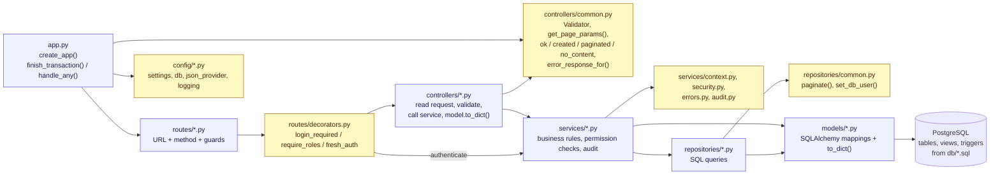

| Layer | Files |
|---|---|
| Entry | [backend/app.py](../backend/app.py), [backend/routes/\_\_init\_\_.py](../backend/routes/__init__.py) |
| Routes | [auth.py](../backend/routes/auth.py), [users.py](../backend/routes/users.py), [reference.py](../backend/routes/reference.py), [masters.py](../backend/routes/masters.py), [health.py](../backend/routes/health.py), [decorators.py](../backend/routes/decorators.py) |
| Controllers | [auth.py](../backend/controllers/auth.py), [users.py](../backend/controllers/users.py), [reference.py](../backend/controllers/reference.py), [masters.py](../backend/controllers/masters.py), [health.py](../backend/controllers/health.py), [common.py](../backend/controllers/common.py) |
| Services | [auth.py](../backend/services/auth.py), [users.py](../backend/services/users.py), [reference.py](../backend/services/reference.py), [branches.py](../backend/services/branches.py), [health.py](../backend/services/health.py), [audit.py](../backend/services/audit.py), [context.py](../backend/services/context.py), [security.py](../backend/services/security.py), [errors.py](../backend/services/errors.py) |
| Repositories | [users.py](../backend/repositories/users.py), [sessions.py](../backend/repositories/sessions.py), [settings.py](../backend/repositories/settings.py), [common.py](../backend/repositories/common.py) |
| Models | [access.py](../backend/models/access.py) (Role, User, UserRoleScope, UserSession, ActiveSession), [masters.py](../backend/models/masters.py) (Branch), [system.py](../backend/models/system.py) (AuditLog, AppSetting) |
| Config | [settings.py](../backend/config/settings.py), [database.py](../backend/config/database.py), [json_provider.py](../backend/config/json_provider.py), [logging.py](../backend/config/logging.py) |

At startup, `create_app()` ([backend/app.py:18](../backend/app.py#L18)) wires everything once: `get_config` → `configure_logging` → `app.json = JSONProvider(app)` → `db.init_app` → `register_transaction_hook` (after-request commit / rollback, [:34](../backend/app.py#L34)) → `register_error_handlers` ([:50](../backend/app.py#L50)) → `register_blueprints` (adds the `/api/v1` prefix, [routes/\_\_init\_\_.py:41](../backend/routes/__init__.py#L41)) → `register_cli`.

---

<a id="auth-pipeline"></a>
### 2. Shared: authentication pipeline

Every endpoint except `/health` and `/auth/login` runs this **before** its route function. The decorators always run in this order: `@login_required` → `@require_roles(...)` (admin routes only) → `@fresh_auth` (sensitive routes only) → the view.

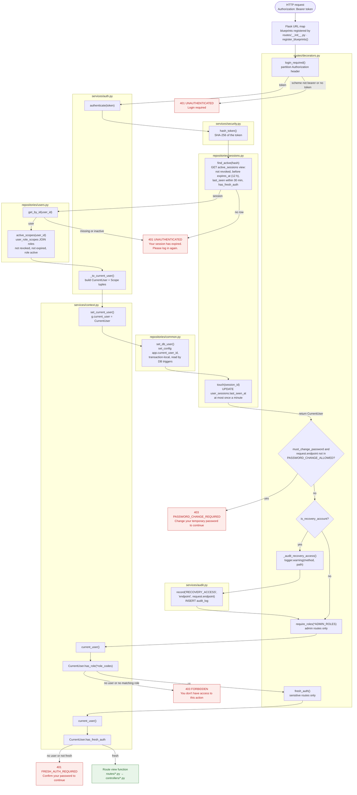

- `PASSWORD_CHANGE_ALLOWED = {"auth.me", "auth.logout", "auth.change_password"}` ([routes/decorators.py:18](../backend/routes/decorators.py#L18)). A user with a temporary password can call only those three endpoints; everything else returns 403 `PASSWORD_CHANGE_REQUIRED`.
- **Idle / max session / fresh auth** are enforced in SQL, not Python. The max session length comes from `trg_user_sessions_expiry`, which sets `expires_at = created_at + session_max_hours` (default 12) on insert ([db/010_prototype_alignment.sql:138](../db/010_prototype_alignment.sql#L138)). The `active_sessions` view ([db/010_prototype_alignment.sql:142](../db/010_prototype_alignment.sql#L142)) drops rows that are revoked, past `expires_at` or idle longer than `session_idle_minutes` (default 30), and computes `has_fresh_auth` as `reauthenticated_at` within `fresh_auth_minutes` (default 15).
- **Recovery accounts:** every request is logged with `logger.warning` and writes a `RECOVERY_ACCESS` audit row **before** the role / fresh-auth checks. The audit row is part of the request transaction, so if the request then fails (status 400 or above) the row is rolled back by `finish_transaction()`; only the log line survives.

**Call trace**

| # | Location | Function | What it does |
|---|---|---|---|
| 1 | [routes/decorators.py:21](../backend/routes/decorators.py#L21) | `login_required` | Reads `Authorization`. Anything other than `Bearer <token>` (case-insensitive scheme) → 401 |
| 2 | [services/auth.py:33](../backend/services/auth.py#L33) | `authenticate` | Resolves the token to the current user |
| 3 | [services/security.py:38](../backend/services/security.py#L38) | `hash_token` | SHA-256. Only the hash is stored |
| 4 | [repositories/sessions.py:15](../backend/repositories/sessions.py#L15) | `find_active` | `db.session.get(ActiveSession, ...)` on the `active_sessions` view |
| 5 | [repositories/users.py:16](../backend/repositories/users.py#L16) | `get_by_id` | Missing or inactive user → 401 |
| 6 | [repositories/users.py:31](../backend/repositories/users.py#L31) | `active_scopes` | Role scopes that are live now (`_active_scope_condition`, [:9](../backend/repositories/users.py#L9)) |
| 7 | [services/auth.py:50](../backend/services/auth.py#L50) | `_to_current_user` | Builds the frozen `CurrentUser` dataclass ([services/context.py:32](../backend/services/context.py#L32)) |
| 8 | [services/context.py:72](../backend/services/context.py#L72) | `set_current_user` | Stores it on `flask.g` |
| 9 | [repositories/common.py:13](../backend/repositories/common.py#L13) | `set_db_user` | `set_config('app.current_user_id', ..., true)` for triggers |
| 10 | [repositories/sessions.py:29](../backend/repositories/sessions.py#L29) | `touch` | Updates `last_seen_at` (at most once a minute) |
| 11 | [routes/decorators.py:29](../backend/routes/decorators.py#L29) | `login_required` | Forced password change check |
| 12 | [routes/decorators.py:38](../backend/routes/decorators.py#L38) → [services/audit.py:17](../backend/services/audit.py#L17) | `_audit_recovery_access` → `record` | Recovery accounts: every request is audited |
| 13 | [routes/decorators.py:45](../backend/routes/decorators.py#L45) | `require_roles` | Any matching role at any branch, via [services/context.py:50](../backend/services/context.py#L50) `has_role`. Branch-level checks happen in services |
| 14 | [routes/decorators.py:61](../backend/routes/decorators.py#L61) | `fresh_auth` | Needs `has_fresh_auth` from the session view |

---

<a id="response-pipeline"></a>
### 3. Shared: response, error and transaction pipeline

Every endpoint **finishes** through this. One DB transaction covers the whole request.

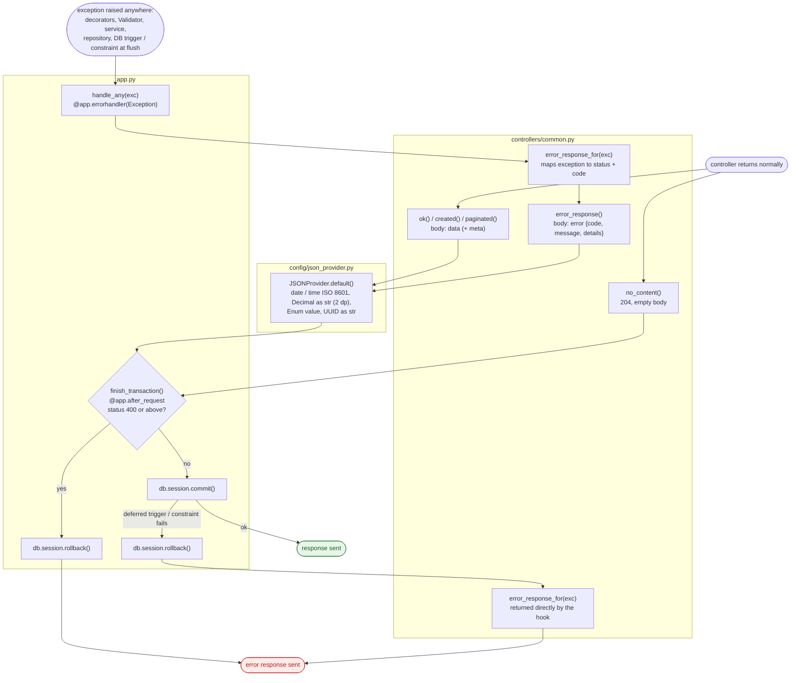

**How `error_response_for` maps exceptions** ([controllers/common.py:337](../backend/controllers/common.py#L337), Postgres table `PG_ERRORS` at [:326](../backend/controllers/common.py#L326))

| Exception | Status | `code` | `message` / `details` |
|---|---|---|---|
| `AppError` subclasses ([services/errors.py](../backend/services/errors.py)): `ValidationError` 400, `Unauthenticated` 401, `FreshAuthRequired` 401, `Forbidden` 403, `PasswordChangeRequired` 403, `NotFound` 404, `Conflict` 409, `BusinessRule` 422, `TooManyAttempts` 429 | its own | its own | its own |
| `ValidationError` from `Validator.validate()` | 400 | `VALIDATION_ERROR` | `Invalid request data`, field messages in `details` |
| werkzeug `HTTPException` (for example a non-integer `<int:user_id>` → 404, wrong method → 405) | its own | name upper-cased, e.g. `NOT_FOUND`, `METHOD_NOT_ALLOWED` | werkzeug description |
| `DBAPIError`, SQLSTATE `P0001` trigger `RAISE`, `23514` check, `23P01` exclusion, `23502` not null | 422 | `BUSINESS_RULE` | Postgres primary message; `details.constraint` / `details.detail` when present |
| `DBAPIError`, SQLSTATE `23503` foreign key | 422 | `INVALID_REFERENCE` | as above |
| `DBAPIError`, SQLSTATE `23505` unique | 409 | `CONFLICT` | as above |
| `DBAPIError`, SQLSTATE `22P02` bad text / enum | 400 | `VALIDATION_ERROR` | as above |
| Anything else (incl. other SQLSTATEs) | 500 | `INTERNAL_ERROR` | `Something went wrong` (logged with `logger.exception`) |

**Request input helpers** (all in [controllers/common.py](../backend/controllers/common.py)): `json_body()` ([:52](../backend/controllers/common.py#L52)) returns `{}` for a missing or non-object body, so missing fields surface as `Required`; `Validator` ([:61](../backend/controllers/common.py#L61)) keeps only fields present in the input (or with a default), with `string`, `email` (trimmed, lower-cased, max 255), `integer`, `boolean`, `datetime` (ISO 8601 with offset), `list_of` and others; `get_page_params()` ([:307](../backend/controllers/common.py#L307)) reads `page` (default 1, min 1) and `per_page` (default 25, max 100) and raises `Invalid pagination parameters`.

---

<a id="grant-subflow"></a>
### 4. Shared sub-flow: `services/users.py · _grant()`

Used by **POST `/users`** (once per scope in the request), **POST `/users/<id>/scopes`** and the `flask create-admin` CLI. Source: [backend/services/users.py:135](../backend/services/users.py#L135).

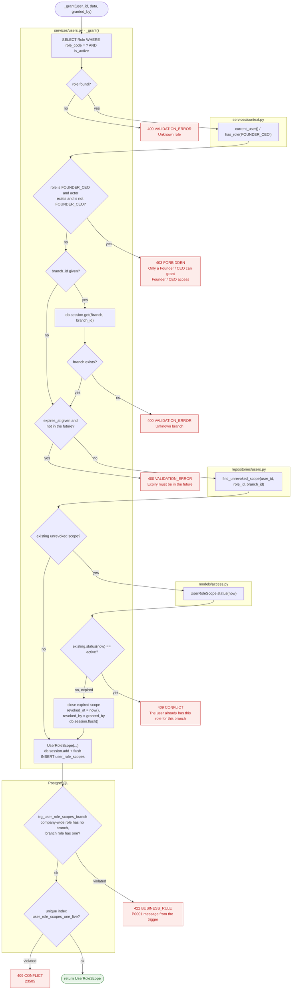

| # | Location | What |
|---|---|---|
| 1 | [repositories/users.py:52](../backend/repositories/users.py#L52) | `find_unrevoked_scope` — the (user, role, branch) slot, active or expired |
| 2 | [models/access.py:100](../backend/models/access.py#L100) | `UserRoleScope.status` — `revoked` / `expired` / `active` |
| 3 | [db/010_prototype_alignment.sql:84](../db/010_prototype_alignment.sql#L84) | `trg_user_role_scopes_branch` |
| 4 | [db/010_prototype_alignment.sql:65](../db/010_prototype_alignment.sql#L65) | `user_role_scopes_one_live` unique index |

---

### 5. Endpoints

<a id="health"></a>
#### 5.1 GET `/api/v1/health`

Public. Checks that the app is up and that it can reach the database.

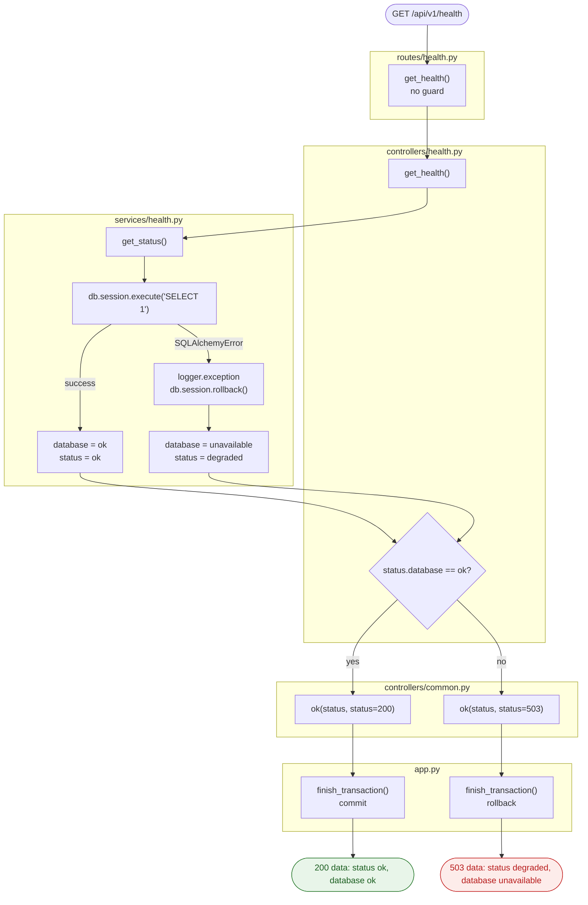

| # | Location | Function |
|---|---|---|
| 1 | [routes/health.py:9](../backend/routes/health.py#L9) | `get_health` |
| 2 | [controllers/health.py:5](../backend/controllers/health.py#L5) | `get_health` |
| 3 | [services/health.py:12](../backend/services/health.py#L12) | `get_status` |
| 4 | [controllers/common.py:24](../backend/controllers/common.py#L24) | `ok` |

---

<a id="auth-login"></a>
#### 5.2 POST `/api/v1/auth/login`

Public. Body: `{email, password}`. Returns a token plus the same profile that `/auth/me` returns.

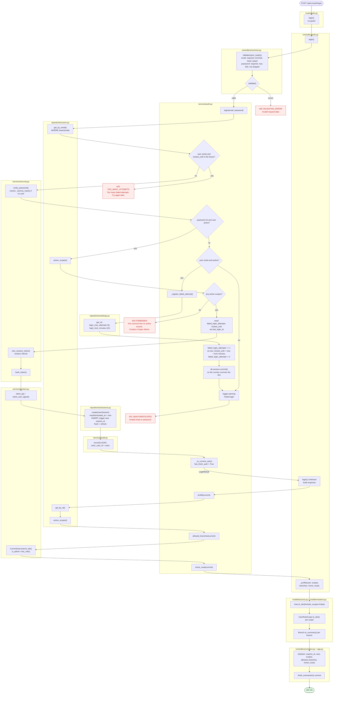

| # | Location | Function |
|---|---|---|
| 1 | [routes/auth.py:10](../backend/routes/auth.py#L10) | `login` |
| 2 | [controllers/auth.py:15](../backend/controllers/auth.py#L15) | `login` (Validator rules) |
| 3 | [services/auth.py:67](../backend/services/auth.py#L67) | `login` |
| 4 | [repositories/users.py:20](../backend/repositories/users.py#L20) | `get_by_email` |
| 5 | [services/security.py:19](../backend/services/security.py#L19) | `verify_password` (constant-time for unknown emails) |
| 6 | [services/auth.py:102](../backend/services/auth.py#L102) → [repositories/settings.py:15](../backend/repositories/settings.py#L15) | `_register_failed_attempt` → `get_int` |
| 7 | [repositories/users.py:31](../backend/repositories/users.py#L31) | `active_scopes` |
| 8 | [services/security.py:33](../backend/services/security.py#L33), [:38](../backend/services/security.py#L38) | `new_session_token`, `hash_token` |
| 9 | [repositories/sessions.py:8](../backend/repositories/sessions.py#L8) | `create` |
| 10 | [services/audit.py:17](../backend/services/audit.py#L17) | `record("LOGIN")`. The actor is passed explicitly because no user is in context yet |
| 11 | [services/auth.py:123](../backend/services/auth.py#L123), [:131](../backend/services/auth.py#L131), [:139](../backend/services/auth.py#L139) | `profile`, `allowed_branches`, `home_route` |
| 12 | [controllers/auth.py:6](../backend/controllers/auth.py#L6) | `_profile` → [User.to_dict](../backend/models/access.py#L61), [UserRoleScope.to_dict](../backend/models/access.py#L107), [Branch.to_summary](../backend/models/masters.py#L38) |

---

<a id="auth-logout"></a>
#### 5.3 POST `/api/v1/auth/logout`

Logged in (allowed during a forced password change). Revokes the current session.

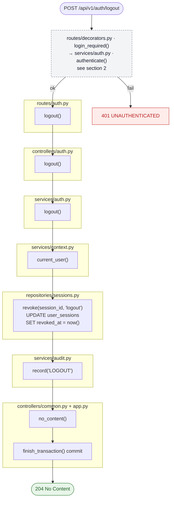

| # | Location | Function |
|---|---|---|
| 1 | [routes/auth.py:16](../backend/routes/auth.py#L16) | `logout` |
| 2 | [controllers/auth.py:26](../backend/controllers/auth.py#L26) | `logout` |
| 3 | [services/auth.py:115](../backend/services/auth.py#L115) | `logout` |
| 4 | [repositories/sessions.py:44](../backend/repositories/sessions.py#L44) | `revoke` |
| 5 | [services/audit.py:17](../backend/services/audit.py#L17) | `record` |

---

<a id="auth-me"></a>
#### 5.4 GET `/api/v1/auth/me`

Logged in (allowed during a forced password change). Returns the user, active scopes, allowed branches and landing route.

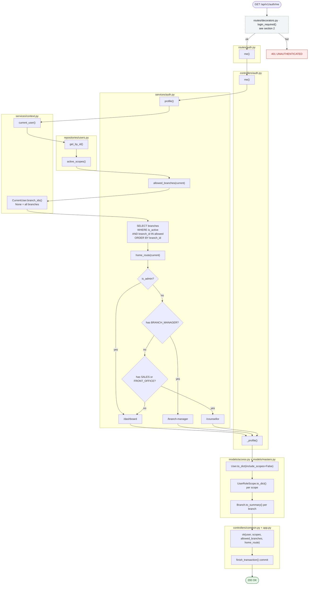

| # | Location | Function |
|---|---|---|
| 1 | [routes/auth.py:22](../backend/routes/auth.py#L22) | `me` |
| 2 | [controllers/auth.py:31](../backend/controllers/auth.py#L31) | `me` |
| 3 | [services/auth.py:123](../backend/services/auth.py#L123) | `profile` |
| 4 | [services/auth.py:131](../backend/services/auth.py#L131) → [services/context.py:57](../backend/services/context.py#L57) | `allowed_branches` → `branch_ids` |
| 5 | [services/auth.py:139](../backend/services/auth.py#L139) | `home_route` |
| 6 | [controllers/auth.py:6](../backend/controllers/auth.py#L6) | `_profile` |

---

<a id="auth-reauthenticate"></a>
#### 5.5 POST `/api/v1/auth/reauthenticate`

Logged in. Body: `{password}`. Refreshes `reauthenticated_at` so that `@fresh_auth` routes pass for the next `fresh_auth_minutes` (15). This endpoint is **not** in `PASSWORD_CHANGE_ALLOWED`, so a user with a temporary password gets 403.

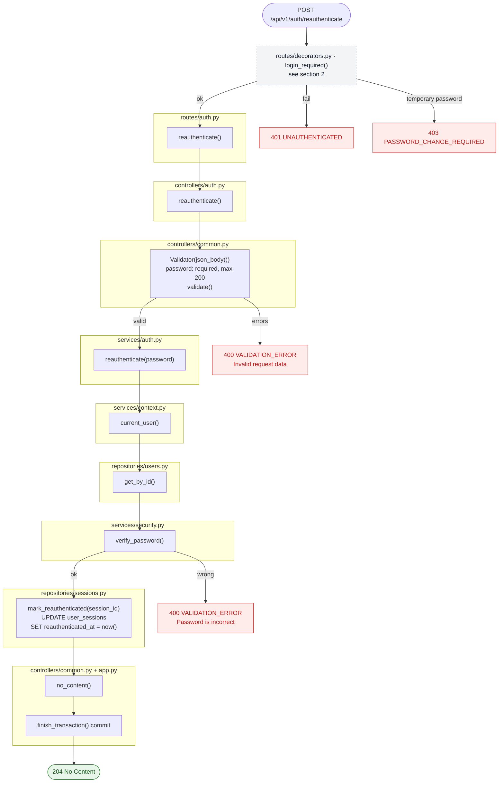

| # | Location | Function |
|---|---|---|
| 1 | [routes/auth.py:28](../backend/routes/auth.py#L28) | `reauthenticate` |
| 2 | [controllers/auth.py:35](../backend/controllers/auth.py#L35) | `reauthenticate` (Validator rules) |
| 3 | [services/auth.py:152](../backend/services/auth.py#L152) | `reauthenticate` |
| 4 | [repositories/sessions.py:38](../backend/repositories/sessions.py#L38) | `mark_reauthenticated` |

---

<a id="auth-change-password"></a>
#### 5.6 POST `/api/v1/auth/change-password`

Logged in (allowed during a forced password change). Body: `{current_password, new_password}`. Signs out every other session.

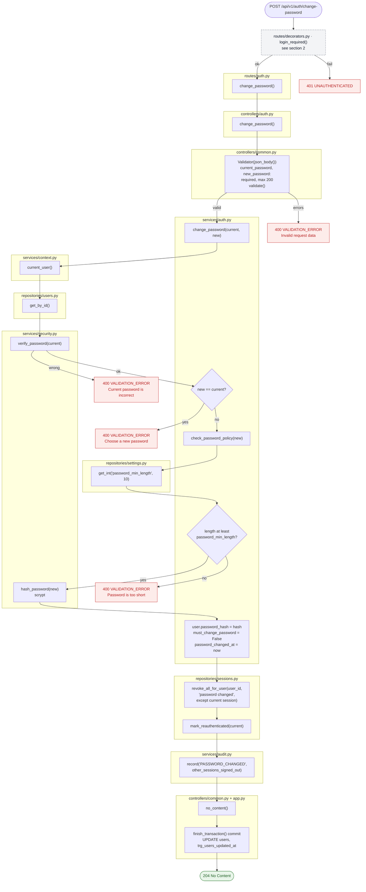

| # | Location | Function |
|---|---|---|
| 1 | [routes/auth.py:34](../backend/routes/auth.py#L34) | `change_password` |
| 2 | [controllers/auth.py:42](../backend/controllers/auth.py#L42) | `change_password` (Validator rules) |
| 3 | [services/auth.py:166](../backend/services/auth.py#L166) | `change_password` |
| 4 | [services/auth.py:160](../backend/services/auth.py#L160) | `check_password_policy` |
| 5 | [services/security.py:15](../backend/services/security.py#L15) | `hash_password` |
| 6 | [repositories/sessions.py:52](../backend/repositories/sessions.py#L52), [:38](../backend/repositories/sessions.py#L38) | `revoke_all_for_user`, `mark_reauthenticated` |
| 7 | [db/002_phase0_foundation.sql:102](../db/002_phase0_foundation.sql#L102) | `trg_users_updated_at` |

---

<a id="auth-sessions"></a>
#### 5.7 GET `/api/v1/auth/sessions`

Logged in. Lists the caller's own active sessions and marks the current one.

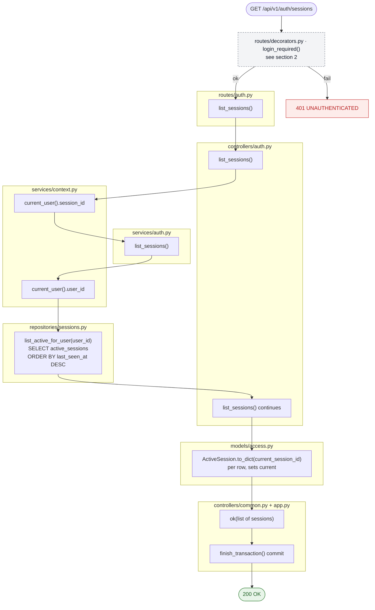

| # | Location | Function |
|---|---|---|
| 1 | [routes/auth.py:40](../backend/routes/auth.py#L40) | `list_sessions` |
| 2 | [controllers/auth.py:52](../backend/controllers/auth.py#L52) | `list_sessions` |
| 3 | [services/auth.py:185](../backend/services/auth.py#L185) | `list_sessions` |
| 4 | [repositories/sessions.py:24](../backend/repositories/sessions.py#L24) | `list_active_for_user` |
| 5 | [models/access.py:158](../backend/models/access.py#L158) | `ActiveSession.to_dict` |

---

<a id="auth-revoke-session"></a>
#### 5.8 DELETE `/api/v1/auth/sessions/<session_id>`

Logged in. `session_id` is the hashed id returned by `GET /auth/sessions`. Only the caller's own sessions can be revoked.

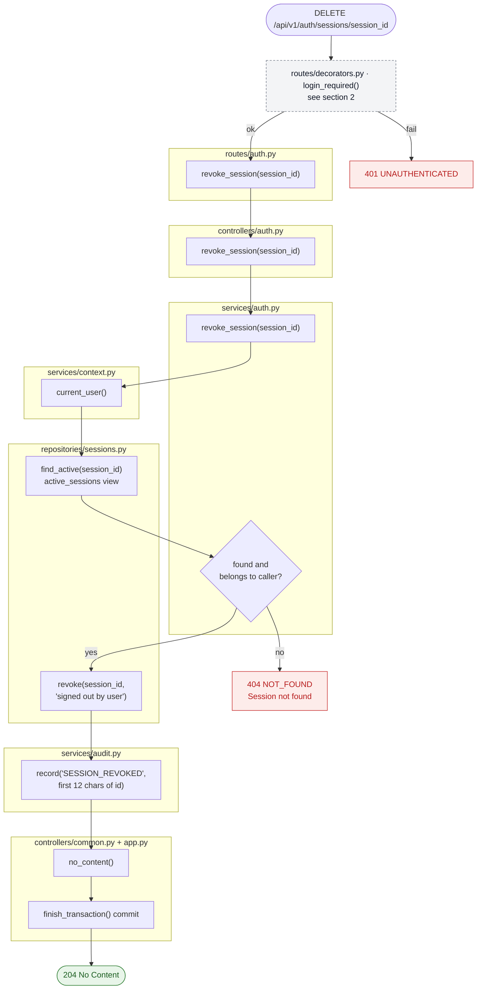

| # | Location | Function |
|---|---|---|
| 1 | [routes/auth.py:46](../backend/routes/auth.py#L46) | `revoke_session` |
| 2 | [controllers/auth.py:57](../backend/controllers/auth.py#L57) | `revoke_session` |
| 3 | [services/auth.py:189](../backend/services/auth.py#L189) | `revoke_session` |
| 4 | [repositories/sessions.py:15](../backend/repositories/sessions.py#L15), [:44](../backend/repositories/sessions.py#L44) | `find_active`, `revoke` |

---

<a id="users-list"></a>
#### 5.9 GET `/api/v1/users`

Admin. Query parameters: `role`, `branch_id`, `is_active`, `q`, `page`, `per_page`.

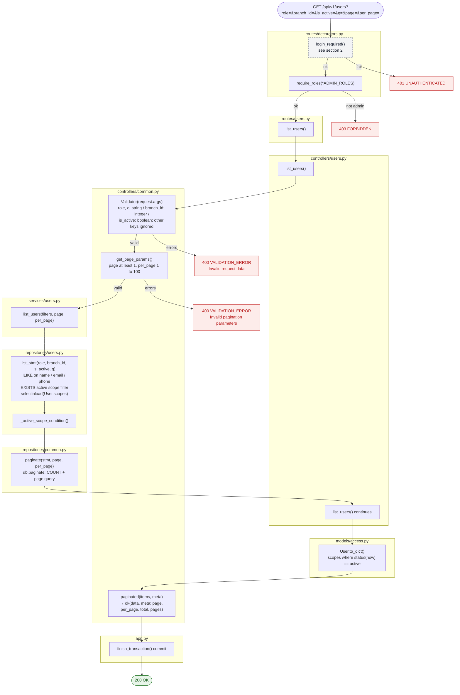

| # | Location | Function |
|---|---|---|
| 1 | [routes/users.py:14](../backend/routes/users.py#L14) | `list_users` |
| 2 | [controllers/users.py:14](../backend/controllers/users.py#L14) | `list_users` (Validator rules) |
| 3 | [controllers/common.py:307](../backend/controllers/common.py#L307) | `get_page_params` |
| 4 | [services/users.py:31](../backend/services/users.py#L31) | `list_users` |
| 5 | [repositories/users.py:86](../backend/repositories/users.py#L86) | `list_stmt` |
| 6 | [repositories/common.py:7](../backend/repositories/common.py#L7) | `paginate` |
| 7 | [models/access.py:61](../backend/models/access.py#L61) | `User.to_dict` |
| 8 | [controllers/common.py:39](../backend/controllers/common.py#L39) | `paginated` |

---

<a id="users-create"></a>
#### 5.10 POST `/api/v1/users`

Admin + fresh auth. Body: `{full_name, email, phone?, person_id?, is_recovery_account?, scopes: [{role_code, branch_id?, expires_at?}, ...]}`. Returns the user and a **one-time** temporary password.

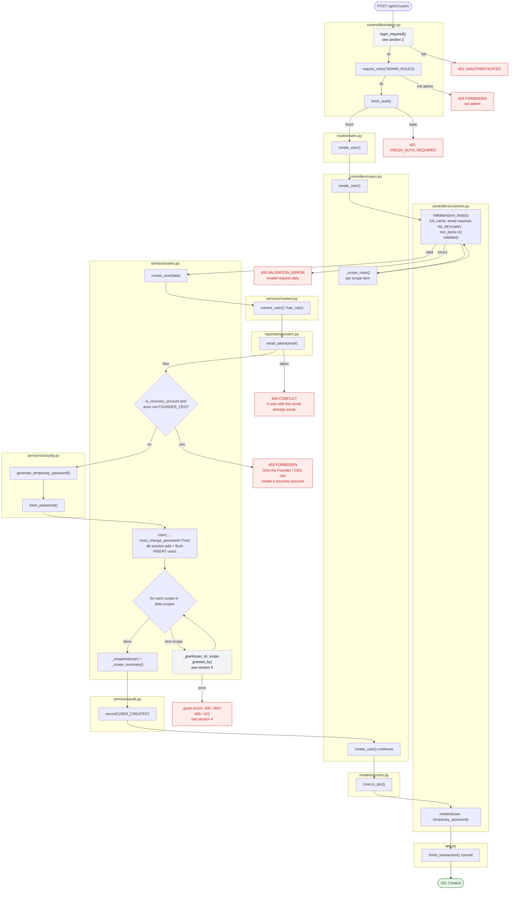

| # | Location | Function |
|---|---|---|
| 1 | [routes/users.py:22](../backend/routes/users.py#L22) | `create_user` |
| 2 | [controllers/users.py:27](../backend/controllers/users.py#L27) | `create_user` (Validator rules; `_scope_rules`, [:8](../backend/controllers/users.py#L8)) |
| 3 | [services/users.py:43](../backend/services/users.py#L43) | `create_user` |
| 4 | [repositories/users.py:24](../backend/repositories/users.py#L24) | `email_taken` |
| 5 | [services/security.py:43](../backend/services/security.py#L43), [:15](../backend/services/security.py#L15) | `generate_temporary_password`, `hash_password` |
| 6 | [services/users.py:135](../backend/services/users.py#L135) | `_grant` (per scope) |
| 7 | [services/audit.py:17](../backend/services/audit.py#L17) | `record("USER_CREATED")` |
| 8 | [controllers/common.py:31](../backend/controllers/common.py#L31) | `created` |

---

<a id="users-get"></a>
#### 5.11 GET `/api/v1/users/<user_id>`

Admin. `<int:user_id>`: a non-integer id never reaches the view and returns a werkzeug 404.

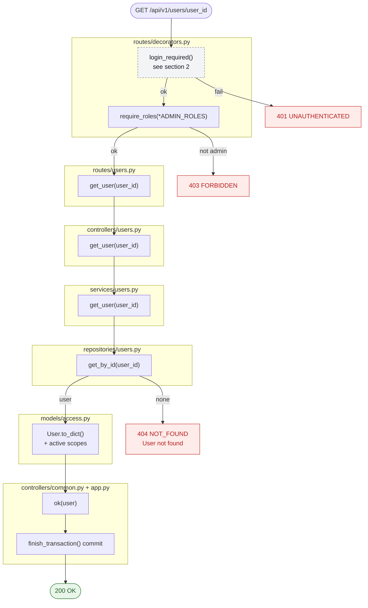

| # | Location | Function |
|---|---|---|
| 1 | [routes/users.py:29](../backend/routes/users.py#L29) | `get_user` |
| 2 | [controllers/users.py:42](../backend/controllers/users.py#L42) | `get_user` |
| 3 | [services/users.py:36](../backend/services/users.py#L36) | `get_user` |
| 4 | [repositories/users.py:16](../backend/repositories/users.py#L16) | `get_by_id` |

---

<a id="users-update"></a>
#### 5.12 PATCH `/api/v1/users/<user_id>`

Admin (no fresh auth). Body: any of `{full_name, email, phone, is_active}`, with at least one field. Deactivating a user signs out all of their sessions.

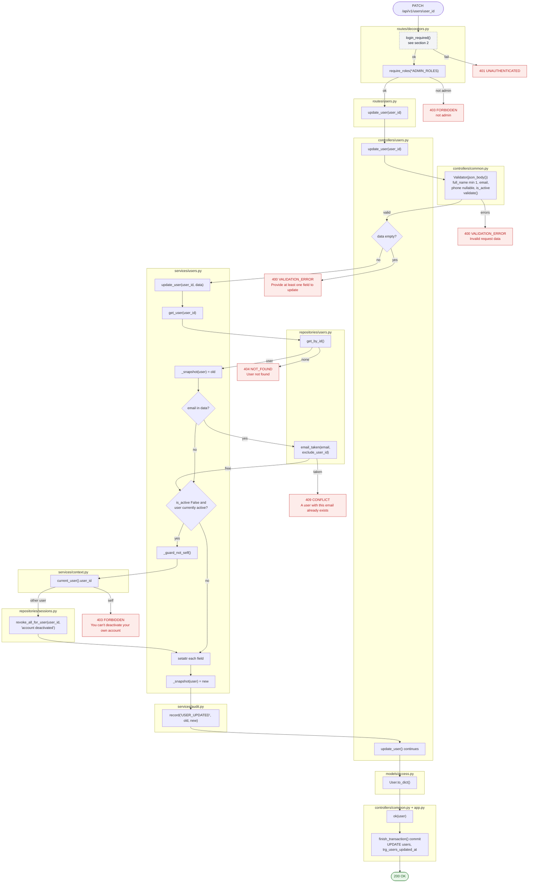

| # | Location | Function |
|---|---|---|
| 1 | [routes/users.py:36](../backend/routes/users.py#L36) | `update_user` |
| 2 | [controllers/users.py:46](../backend/controllers/users.py#L46) | `update_user` (Validator rules + empty check) |
| 3 | [services/users.py:70](../backend/services/users.py#L70) | `update_user` |
| 4 | [services/users.py:24](../backend/services/users.py#L24) | `_guard_not_self` |
| 5 | [repositories/sessions.py:52](../backend/repositories/sessions.py#L52) | `revoke_all_for_user` |

---

<a id="users-reset-password"></a>
#### 5.13 POST `/api/v1/users/<user_id>/reset-password`

Admin + fresh auth. Issues a new temporary password, unlocks the account and signs out every session for that user.

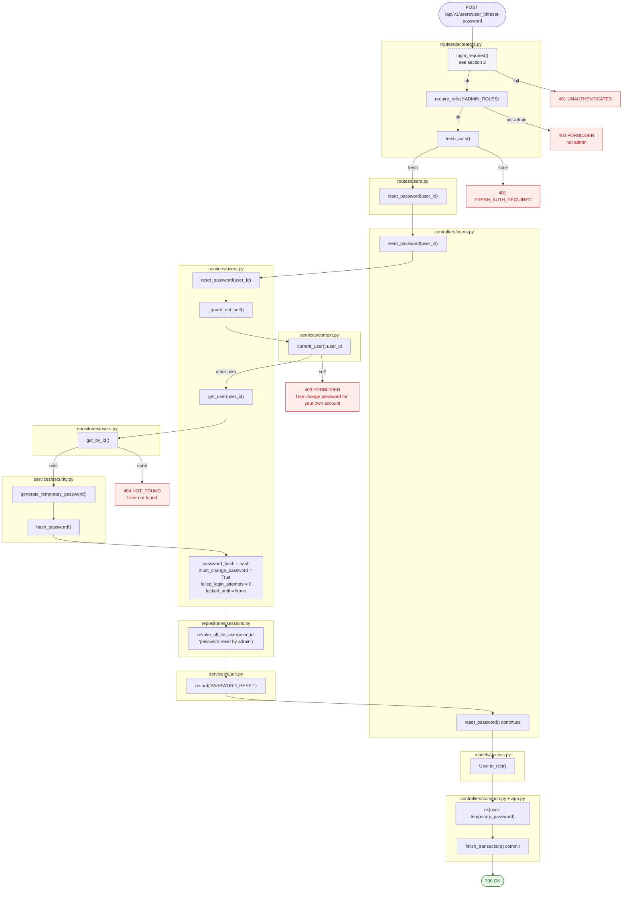

| # | Location | Function |
|---|---|---|
| 1 | [routes/users.py:44](../backend/routes/users.py#L44) | `reset_password` |
| 2 | [controllers/users.py:59](../backend/controllers/users.py#L59) | `reset_password` |
| 3 | [services/users.py:89](../backend/services/users.py#L89) | `reset_password` |
| 4 | [repositories/sessions.py:52](../backend/repositories/sessions.py#L52) | `revoke_all_for_user` |

---

<a id="users-scopes-list"></a>
#### 5.14 GET `/api/v1/users/<user_id>/scopes`

Admin. Returns every scope, including expired and revoked ones, each with a computed `status`.

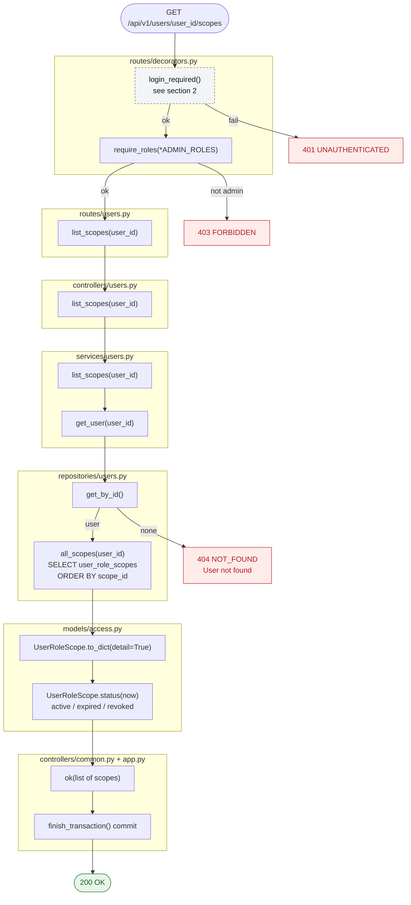

| # | Location | Function |
|---|---|---|
| 1 | [routes/users.py:51](../backend/routes/users.py#L51) | `list_scopes` |
| 2 | [controllers/users.py:64](../backend/controllers/users.py#L64) | `list_scopes` |
| 3 | [services/users.py:106](../backend/services/users.py#L106) | `list_scopes` |
| 4 | [repositories/users.py:41](../backend/repositories/users.py#L41) | `all_scopes` |
| 5 | [models/access.py:107](../backend/models/access.py#L107) | `UserRoleScope.to_dict` |

---

<a id="users-scopes-grant"></a>
#### 5.15 POST `/api/v1/users/<user_id>/scopes`

Admin + fresh auth. Body: `{role_code, branch_id?, expires_at?}`.

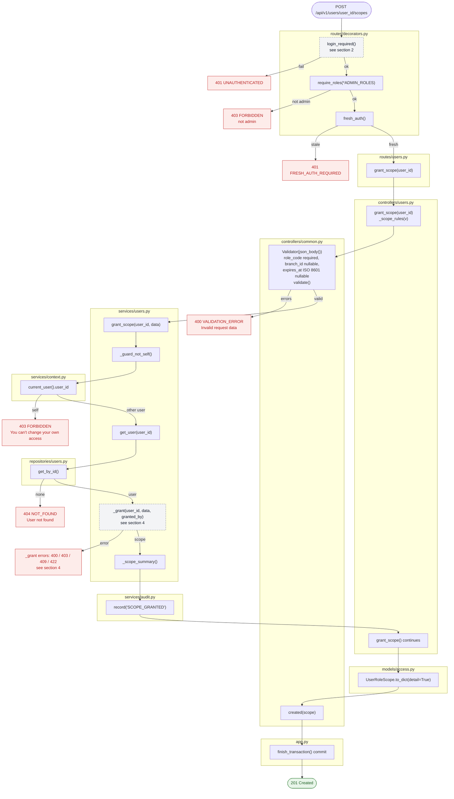

| # | Location | Function |
|---|---|---|
| 1 | [routes/users.py:59](../backend/routes/users.py#L59) | `grant_scope` |
| 2 | [controllers/users.py:68](../backend/controllers/users.py#L68) | `grant_scope` (`_scope_rules`, [:8](../backend/controllers/users.py#L8)) |
| 3 | [services/users.py:111](../backend/services/users.py#L111) | `grant_scope` |
| 4 | [services/users.py:135](../backend/services/users.py#L135) | `_grant` |

---

<a id="users-scopes-revoke"></a>
#### 5.16 DELETE `/api/v1/users/<user_id>/scopes/<scope_id>`

Admin + fresh auth. This is a soft revoke: it sets `revoked_at` and never deletes the row. It returns **200 with the revoked scope**, not 204.

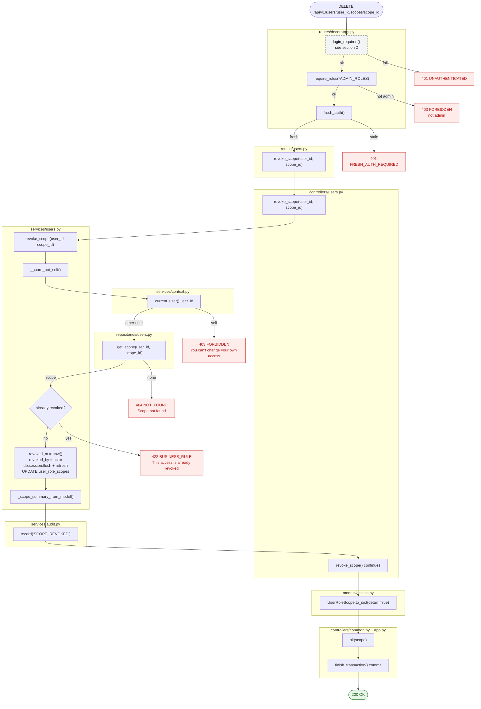

| # | Location | Function |
|---|---|---|
| 1 | [routes/users.py:67](../backend/routes/users.py#L67) | `revoke_scope` |
| 2 | [controllers/users.py:74](../backend/controllers/users.py#L74) | `revoke_scope` |
| 3 | [services/users.py:119](../backend/services/users.py#L119) | `revoke_scope` |
| 4 | [repositories/users.py:46](../backend/repositories/users.py#L46) | `get_scope` |

---

<a id="roles"></a>
#### 5.17 GET `/api/v1/roles`

Logged in. Active roles, for dropdowns.

```mermaid
flowchart TD
    classDef err fill:#fdecea,stroke:#c62828,color:#b71c1c
    classDef done fill:#e8f5e9,stroke:#2e7d32,color:#1b5e20
    classDef shared fill:#f3f4f6,stroke:#6b7280,stroke-dasharray:4 3,color:#111827

    REQ(["GET /api/v1/roles"])
    LR["routes/decorators.py · login_required()<br/>see section 2"]:::shared

    subgraph sgR["routes/reference.py"]
        R1["list_roles()"]
    end
    subgraph sgC["controllers/reference.py"]
        C1["list_roles()"]
    end
    subgraph sgS["services/reference.py"]
        S1["list_roles()<br/>SELECT roles WHERE is_active<br/>ORDER BY role_id"]
    end
    subgraph sgM["models/access.py"]
        D1["Role.to_dict() per role"]
    end
    subgraph sgResp["controllers/common.py + app.py"]
        OK["ok(list of roles)"]
        FT["finish_transaction() commit"]
    end

    E401["401 UNAUTHENTICATED"]:::err
    E403["403 PASSWORD_CHANGE_REQUIRED"]:::err
    RES(["200 OK"]):::done

    REQ --> LR
    LR -->|fail| E401
    LR -->|temporary password| E403
    LR -->|ok| R1 --> C1 --> S1 --> D1 --> OK --> FT --> RES
```

| # | Location | Function |
|---|---|---|
| 1 | [routes/reference.py:11](../backend/routes/reference.py#L11) | `list_roles` |
| 2 | [controllers/reference.py:7](../backend/controllers/reference.py#L7) | `list_roles` |
| 3 | [services/reference.py:11](../backend/services/reference.py#L11) | `list_roles` |
| 4 | [models/access.py:24](../backend/models/access.py#L24) | `Role.to_dict` |

---

<a id="branches"></a>
#### 5.18 GET `/api/v1/branches`

Logged in. Lives in the masters blueprint. Returns **all** active branches, with no filter by the caller's scopes. The caller's own branches come from `allowed_branches` in `/auth/me`.

```mermaid
flowchart TD
    classDef err fill:#fdecea,stroke:#c62828,color:#b71c1c
    classDef done fill:#e8f5e9,stroke:#2e7d32,color:#1b5e20
    classDef shared fill:#f3f4f6,stroke:#6b7280,stroke-dasharray:4 3,color:#111827

    REQ(["GET /api/v1/branches"])
    LR["routes/decorators.py · login_required()<br/>see section 2"]:::shared

    subgraph sgR["routes/masters.py"]
        R1["list_branches()"]
    end
    subgraph sgC["controllers/masters.py"]
        C1["list_branches()"]
    end
    subgraph sgS["services/branches.py"]
        S1["list_branches()<br/>SELECT branches WHERE is_active<br/>ORDER BY branch_id"]
    end
    subgraph sgM["models/masters.py"]
        D1["Branch.to_dict() per branch"]
    end
    subgraph sgResp["controllers/common.py + app.py"]
        OK["ok(list of branches)"]
        FT["finish_transaction() commit"]
    end

    E401["401 UNAUTHENTICATED"]:::err
    E403["403 PASSWORD_CHANGE_REQUIRED"]:::err
    RES(["200 OK"]):::done

    REQ --> LR
    LR -->|fail| E401
    LR -->|temporary password| E403
    LR -->|ok| R1 --> C1 --> S1 --> D1 --> OK --> FT --> RES
```

| # | Location | Function |
|---|---|---|
| 1 | [routes/masters.py:44](../backend/routes/masters.py#L44) | `list_branches` |
| 2 | [controllers/masters.py:55](../backend/controllers/masters.py#L55) | `list_branches` |
| 3 | [services/branches.py:12](../backend/services/branches.py#L12) | `list_branches` |
| 4 | [models/masters.py:25](../backend/models/masters.py#L25) | `Branch.to_dict` |

---

<a id="branches-get"></a>
#### 5.19 GET `/api/v1/branches/<branch_id>`

Logged in (no role check and no branch-scope check in the code). Returns one branch, active or not.

```mermaid
flowchart TD
    classDef err fill:#fdecea,stroke:#c62828,color:#b71c1c
    classDef done fill:#e8f5e9,stroke:#2e7d32,color:#1b5e20
    classDef shared fill:#f3f4f6,stroke:#6b7280,stroke-dasharray:4 3,color:#111827

    REQ(["GET /api/v1/branches/branch_id"])
    LR["routes/decorators.py · login_required()<br/>see section 2"]:::shared

    subgraph sgR["routes/masters.py"]
        R1["get_branch(branch_id)"]
    end
    subgraph sgC["controllers/masters.py"]
        C1["get_branch(branch_id)"]
    end
    subgraph sgS["services/branches.py"]
        S1["get_branch(branch_id)<br/>db.session.get(Branch, branch_id)"]
    end
    subgraph sgM["models/masters.py"]
        D1["Branch.to_dict()"]
    end
    subgraph sgResp["controllers/common.py + app.py"]
        OK["ok(branch)"]
        FT["finish_transaction() commit"]
    end

    E401["401 UNAUTHENTICATED"]:::err
    E403["403 PASSWORD_CHANGE_REQUIRED"]:::err
    E404["404 NOT_FOUND<br/>Branch not found"]:::err
    RES(["200 OK"]):::done

    REQ --> LR
    LR -->|fail| E401
    LR -->|temporary password| E403
    LR -->|ok| R1 --> C1 --> S1
    S1 -->|none| E404
    S1 -->|branch| D1 --> OK --> FT --> RES
```

| # | Location | Function |
|---|---|---|
| 1 | [routes/masters.py:50](../backend/routes/masters.py#L50) | `get_branch` |
| 2 | [controllers/masters.py:59](../backend/controllers/masters.py#L59) | `get_branch` |
| 3 | [services/branches.py:16](../backend/services/branches.py#L16) | `get_branch` |

---

<a id="branches-update"></a>
#### 5.20 PATCH `/api/v1/branches/<branch_id>`

Admin (no fresh auth). Body: any of `{branch_name, city, address, phone, email}`, with at least one field. Contact details only; `branch_code` and `receipt_prefix` can't be changed here.

```mermaid
flowchart TD
    classDef err fill:#fdecea,stroke:#c62828,color:#b71c1c
    classDef done fill:#e8f5e9,stroke:#2e7d32,color:#1b5e20
    classDef shared fill:#f3f4f6,stroke:#6b7280,stroke-dasharray:4 3,color:#111827

    REQ(["PATCH /api/v1/branches/branch_id"])

    subgraph sgG["routes/decorators.py"]
        LR["login_required()<br/>see section 2"]:::shared
        RR["require_roles(*ADMIN_ROLES)"]
    end
    subgraph sgR["routes/masters.py"]
        R1["update_branch(branch_id)"]
    end
    subgraph sgC["controllers/masters.py"]
        C1["update_branch(branch_id)"]
        CE["_require_changes(data)"]
    end
    subgraph sgV["controllers/common.py"]
        V1["Validator(json_body())<br/>branch_name, city: min 1, max 100<br/>address, phone, email: nullable<br/>validate()"]
    end
    subgraph sgS["services/branches.py"]
        S1["update_branch(branch_id, data)"]
        S2["get_branch(branch_id)"]
        S3["old = branch.to_dict()<br/>setattr each field<br/>db.session.flush()"]
    end
    subgraph sgA["services/audit.py"]
        A1["record('BRANCH_UPDATED',<br/>old, new, branch_id)"]
    end
    subgraph sgM["models/masters.py"]
        D1["Branch.to_dict()"]
    end
    subgraph sgResp["controllers/common.py + app.py"]
        OK["ok(branch)"]
        FT["finish_transaction() commit"]
    end

    E401["401 UNAUTHENTICATED"]:::err
    E403["403 FORBIDDEN<br/>not admin"]:::err
    E400["400 VALIDATION_ERROR<br/>Invalid request data"]:::err
    E400E["400 VALIDATION_ERROR<br/>Provide at least one field to update"]:::err
    E404["404 NOT_FOUND<br/>Branch not found"]:::err
    EDB["DB error at flush<br/>mapped as in section 3"]:::err
    RES(["200 OK"]):::done

    REQ --> LR
    LR -->|fail| E401
    LR -->|ok| RR
    RR -->|not admin| E403
    RR -->|ok| R1 --> C1 --> V1
    V1 -->|errors| E400
    V1 -->|valid| CE
    CE -->|empty| E400E
    CE -->|data| S1 --> S2
    S2 -->|none| E404
    S2 -->|branch| S3
    S3 -->|constraint fails| EDB
    S3 -->|ok| A1 --> D1 --> OK --> FT --> RES
```

| # | Location | Function |
|---|---|---|
| 1 | [routes/masters.py:57](../backend/routes/masters.py#L57) | `update_branch` |
| 2 | [controllers/masters.py:63](../backend/controllers/masters.py#L63) | `update_branch` (Validator rules; `_require_changes`, [:13](../backend/controllers/masters.py#L13)) |
| 3 | [services/branches.py:23](../backend/services/branches.py#L23) | `update_branch` |
| 4 | [services/audit.py:17](../backend/services/audit.py#L17) | `record("BRANCH_UPDATED")` |

---

<a id="staff"></a>
#### 5.21 GET `/api/v1/staff`

Logged in. Query parameters: `branch_id` (optional, whole number 1 or more) and `role` (optional; repeatable and / or comma-separated, e.g. `?role=SALES,FRONT_OFFICE`, upper-cased). Staff directory for owner / trainer / task-owner pickers: active users with active scopes at the caller's branches plus company-wide scopes, one entry per user with every matching role.

```mermaid
flowchart TD
    classDef err fill:#fdecea,stroke:#c62828,color:#b71c1c
    classDef done fill:#e8f5e9,stroke:#2e7d32,color:#1b5e20
    classDef shared fill:#f3f4f6,stroke:#6b7280,stroke-dasharray:4 3,color:#111827

    REQ(["GET /api/v1/staff?branch_id=&role="])
    LR["routes/decorators.py · login_required()<br/>see section 2"]:::shared

    subgraph sgR["routes/reference.py"]
        R1["list_staff()"]
    end
    subgraph sgC["controllers/reference.py"]
        C1["list_staff()"]
        C2["roles = request.args.getlist('role')<br/>split on commas, strip, upper<br/>empty list → None"]
    end
    subgraph sgV["controllers/common.py"]
        V1["Validator(branch_id only)<br/>integer, min_value 1<br/>validate()"]
        OK["ok(list of staff)"]
    end
    subgraph sgS["services/reference.py"]
        S1["list_staff(branch_id, role_codes)"]
        S2{"branch_id given?"}
        S3{"allowed is not None and<br/>branch_id not in allowed?"}
        S4["allowed = {branch_id}"]
        S5["group scopes by user_id<br/>user_id, full_name,<br/>roles: role_code, role_name,<br/>branch_id, branch_code"]
    end
    subgraph sgCtx["services/context.py"]
        X1["current_user()"]
        X2["CurrentUser.branch_ids()<br/>None = all branches"]
    end
    subgraph sgU["repositories/users.py"]
        U1["staff_scopes(role_codes, allowed)<br/>active scopes of active users<br/>role_code IN roles (if given)<br/>branch_id IN allowed OR NULL (if not None)<br/>ORDER BY full_name, user_id, scope_id"]
        U2["_active_scope_condition()"]
    end
    subgraph sgTx["app.py"]
        FT["finish_transaction() commit"]
    end

    E401["401 UNAUTHENTICATED"]:::err
    E403["403 PASSWORD_CHANGE_REQUIRED"]:::err
    E400["400 VALIDATION_ERROR<br/>Invalid request data"]:::err
    E404["404 NOT_FOUND<br/>Branch not found"]:::err
    RES(["200 OK"]):::done

    REQ --> LR
    LR -->|fail| E401
    LR -->|temporary password| E403
    LR -->|ok| R1 --> C1 --> V1
    V1 -->|errors| E400
    V1 -->|valid| C2 --> S1 --> X1 --> X2 --> S2
    S2 -->|yes| S3
    S3 -->|yes| E404
    S3 -->|no| S4 --> U1
    S2 -->|no| U1
    U1 --> U2 --> S5 --> OK --> FT --> RES
```

| # | Location | Function |
|---|---|---|
| 1 | [routes/reference.py:17](../backend/routes/reference.py#L17) | `list_staff` |
| 2 | [controllers/reference.py:11](../backend/controllers/reference.py#L11) | `list_staff` (Validator rule + `role` parsing) |
| 3 | [services/reference.py:15](../backend/services/reference.py#L15) | `list_staff` |
| 4 | [services/context.py:57](../backend/services/context.py#L57) | `CurrentUser.branch_ids` |
| 5 | [repositories/users.py:104](../backend/repositories/users.py#L104) | `staff_scopes` |
